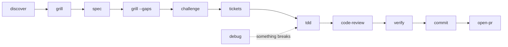

<div align="center">

# hl-skills

### Your coding agent says "done". Make it prove it.

Evidence-first agent skills for Claude Code, Codex, Cursor, Gemini CLI, GitHub Copilot, OpenCode, and any agent that reads `SKILL.md`.

[](https://skills.sh/HugoLopes45/hl-skills)
[](#all-26-skills)
[](./evals/README.md)
[](./LICENSE)

```bash
npx skills add HugoLopes45/hl-skills
```

</div>

---

Coding agents say **"done"** when the tests never ran, **"fixed"** when nobody reproduced the bug, and **"probably"** when nobody checked.

hl-skills makes the agent show its work: every claim comes with a `file:line`, a command and its output, or a source. When it cannot prove a claim, it says **unknown**.

## See the difference

Same request, same branch, same model: *"Review this branch against origin/main."* The diff makes `ratio` return 0 on any exception, and `greet("")` breaks a rule in `spec.md`.

<table>
<tr><th>Bare agent</th><th>With <code>code-review</code></th></tr>
<tr><td>

```
calc.py - ratio (needs a fix):
  except Exception: return 0
  is too broad. [...]

greet.py (looks fine)
```

</td><td>

```
Verdict: Fix 1 S1 finding
| S1 | calc.py:4-5 | except Exception: return 0
                    hides every error [...]       |
| S2 | greet.py:2  | greet("") does not raise
                    ValueError as spec.md item 2
                    requires                      |
Trigger: ratio(1, 0), ratio("a", 2), ratio(None, 1)
Not run: tests, and --deep, --cold and --spec.
```

</td></tr>
</table>

The bare agent marked `greet.py` as fine and missed the spec violation. Trimmed excerpts of two real outputs from the same eval iteration.

## What changes

| Your agent without skills | With hl-skills |
|---|---|
| "Tests pass" (they never ran) | `Not run: tests`, with the command to run them |
| "Fixed the bug" | The bug reproduced by a command, then the defect proven by toggling it |
| "Looks fine" | Each finding with location, trigger, consequence, and evidence |
| "Probably X" | `file:line`, command output, or a source, else **unknown** |
| A wall of prose | Verdict first, then a table, call tree, diff, or diagram |
| Edits your code while "investigating" | Read-only by default; fixes and commits only when you ask |

## Measured, not claimed

Every skill has an eval suite. The same cases run in Claude Code (`sonnet`, 3 repetitions) with the skill and as a bare agent. Runs that pass all checks, main suite plus mode and hard cases:

| Skill | Outcome with | Outcome without | Evidence format with | Evidence format without |
|---|---|---|---|---|
| `verify` | 15/15 | 10/15 | **12/12** | 3/12 |
| `adr` | 9/9 | 3/9 | **6/6** | 0/6 |
| `grill` | 30/30 | 21/30 | **24/24** | 9/24 |
| `code-review` | 15/15 | 11/15 | **15/15** | 1/15 |
| `commit` | 15/15 | 9/15 | **15/15** | 6/15 |
| `debug` | 21/21 | 16/21 | **18/18** | 0/18 |

**A bare agent often finds the right answer. It almost never shows the proof.** The outcome is what you need, such as the right defect line. The evidence format is the skill's contract, such as a citation per finding. All 26 suites, the routing suite, the iterations behind each count, the limits, and how to rerun them: [evals/README.md](./evals/README.md).

## The loop



| You say | Skill | You get |
|---|---|---|
| "Where do I start in this repo?" | `discover` | Purpose, stack, git state, and the real build and test commands |
| "Grill me on the export idea" | `grill` | Rounds of questions, each with a recommended answer |
| "Plan the export feature" | `spec` | Scope, acceptance criteria, assumptions, failure scenarios |
| "What is this spec missing?" | `grill --gaps` | Each gap with a quote and one question |
| "Poke holes in this plan" | `challenge` | Each claim checked against code and evidence; proceed, fix first, or stop |
| "Split the plan into tickets" | `tickets` | End-to-end slices, one pull request each, with what blocks what |
| "Build it test-first" | `tdd` | A test that fails for the right reason, then the smallest change |
| "Why does this fail?" | `debug` | A command that shows the bug, tested hypotheses, the defect proven by toggling it |
| "Review this branch" | `code-review` | Findings with location, trigger, consequence, and evidence |
| "Are we done?" | `verify` | One row per request: passed, failed, unverified, or blocked |

## All 26 skills

### Engineering loop

| Skill | Does |
|---|---|
| `discover` | Orients you in a repository, or maps one area with `--scope` |
| `grill` | Questions you until the idea is clear, with options where a decision needs them; `--docs` keeps a glossary, `--gaps` reports missing decisions and edge cases |
| `spec` | Plans a feature; `--handoff` writes a brief for another agent, `--prd` a product and technical specification with sources |
| `challenge` | Tests the claims of a plan or finished work; `--premortem` traces how it fails; `--lens` and `--panel` apply [fixed review methods](./skills/challenge/references/lenses.md) |
| `tdd` | Builds one behavior with a verified red, green, refactor cycle at an agreed seam |
| `debug` | Builds a feedback loop and proves the root cause; on request, fixes it behind a failing regression test |
| `code-review` | Reviews a diff; `--spec` checks it against the spec, `--deep` adds parallel specialists and an independent skeptic |
| `deslop` | Removes AI-generated slop and invented APIs from a change |
| `verify` | Checks each requested outcome; `--claim` measures before and after, `--text` marks each claim in a text as supported, corrected, or unverified |
| `commit` | Writes a commit message from the staged diff, then commits |
| `open-pr` | Opens a draft pull request with why, changes, verification, and risks |
| `checkpoint` | Saves decisions and the next action before a context reset; `--stuck` names why work goes in circles and what breaks the loop |

### Decide and explain

| Skill | Does |
|---|---|
| `show-me` | Answers with a diagram, a tree, pseudocode, or an interactive HTML page instead of paragraphs |
| `explainer-video` | A short narrated explainer video on one topic, with a local voice by default |
| `spike` | A time-boxed experiment that answers one technical question |
| `adr` | An architecture decision record with the options considered and the cost of reversal |

### Codebase audits

| Skill | Does |
|---|---|
| `security-audit` | Runs scanners and traces untrusted input to dangerous sinks, scored by CWE and CVSS |
| `improve` | Finds the highest-value fixes and writes plans that another agent can run; `arch` writes an architecture report, `refactor` a behavior-preserving refactor in small steps |

### Delivery

| Skill | Does |
|---|---|
| `tickets` | Splits a feature into end-to-end slices, one pull request each, with blocking edges; `--tracker` writes them for Jira, Linear, GitHub, or GitLab |
| `split-pr` | Splits a large diff into pull requests in dependency order |
| `ci-fix` | Fixes failing checks without weakening tests or CI |
| `receive-review` | Decides agree, defer, disagree, or clarify for each review comment |
| `lessons` | Turns a session or a finished change into checks, rules, or pointers, cheapest first |
| `writing-for-agents` | Finds the shortest prompt that gets the behavior; `--skill` writes or reviews a skill |

### Product

| Skill | Does |
|---|---|
| `startup` | Evaluates an idea: assumption, problem, competition, first customers, MVP test; `scout` finds ideas, `ship` and `kill` decide after launch |
| `launch-marketing` | Positioning, landing copy, launch plan, channels, pricing, and offer |

## Recipes

- **Idea to pull request:** `grill` → `spec` → `grill --gaps` → `challenge` → `tdd` for each behavior → `code-review` → `verify` → `commit` → `open-pr`.
- **Production bug:** `debug` to prove the defect, then ask it for the fix.
- **Before a risky merge:** `code-review --deep`, then `deslop` on the change.
- **Large feature:** `grill` to settle the decisions, then `tickets` for one pull request per slice.
- **Inherited codebase:** `discover --depth full`, then `improve arch`, then `improve` to turn findings into plans.
- **Startup idea:** `startup scout` without an idea, `startup` to evaluate one, or one stage with `--stage`. After launch, `startup ship` or `startup kill`.

## Install

The [`skills`](https://github.com/vercel-labs/skills) CLI detects your agents and installs the skills for each one:

```bash
npx skills add HugoLopes45/hl-skills                            # pick skills and agents interactively
npx skills add HugoLopes45/hl-skills --list                     # list the skills
npx skills add HugoLopes45/hl-skills -s code-review -s tdd -g   # some skills, for every project
npx skills add HugoLopes45/hl-skills -a codex -a cursor         # some agents
```

Without `-g`, skills install into the current project. To update, run `npx skills update`.

Your agent loads a skill when your request matches its description. To run one yourself, name it ("use code-review on this branch") or use your agent's syntax, for example `/code-review` in Claude Code.

## Design rules

- **Evidence or "unknown".** A check that did not run is reported as not run, never as a pass.
- **Answer first.** Reports open with the verdict, then show tables, call trees, file trees, and diffs.
- **Read-only by default.** Review and audit skills do not edit your code. `debug` edits only when you ask for the fix. `commit`, `open-pr`, and `ci-fix` act only when you ask.
- **Short.** The average skill is about 53 lines, the longest under 160. Long catalogs live in `references/` and load only when needed.
- **One job per skill.** Variants are modes (`code-review --deep`, `challenge --premortem`), not near-duplicate skills that compete for the same trigger.
- **Methods, not personas.** No "act as a senior engineer", no imitations of famous people.
- **Any agent.** No host-specific tool names. When a step needs subagents or web access your agent lacks, the skill says what to do instead.

## Contributing

Read [CONTRIBUTING.md](./CONTRIBUTING.md) and [STYLE.md](./STYLE.md). `python3 scripts/validate.py` checks the format of each skill and its links. Report vulnerabilities as [SECURITY.md](./SECURITY.md) describes.

## License

[MIT](./LICENSE)
