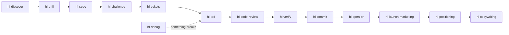

<div align="center">

# hl-skills

### Build it right. Then get it found.

**51 skills that give your coding agent an engineering team and a growth team.**

Question the idea. Write the test. Prove the bug. Ship the PR.

Find your angle. Write the page. Plan the test. Read the numbers.

For Claude Code, Codex, Cursor, Gemini CLI, GitHub Copilot, OpenCode, Pi, and any agent that reads `SKILL.md`.

**[Install](#install)** · [Bring a real problem](#bring-a-real-problem) · [Find your next move](#find-your-next-move) · [See real answers](#real-answers) · [Measured, not promised](#measured-not-promised) · [Questions](#questions) · [简体中文](./README.zh-CN.md)

[](https://github.com/HugoLopes45/hl-skills/actions/workflows/ci.yml)
[](./CHANGELOG.md)
[](./LICENSE)

</div>

Your agent writes fast. It can also guess, agree with you too soon, and fill a gap with proof it does not have. Each skill gives it a tested method for one job and makes it show the evidence: the file and line, the test run, the source, or a visible placeholder where proof is missing.

## Install

```bash
npx skills add HugoLopes45/hl-skills
```

Run it in your project and follow the installer. Requires Node.js 22.20+ and npm. No config, no server, no API key.

Add `--global` for a user-level install. Want only one side? Pick skills with `-s`, such as `-s hl-debug -s hl-tdd` or `-s hl-positioning -s hl-copywriting`.

Then open a fresh agent session and ask:

> Use hl-debug to find why this test fails only in the full suite.

## Bring a real problem

**Your test passes alone and fails in the full suite.** [hl-debug](./skills/hl-debug/SKILL.md) proves which test pollutes the other before it changes a line. Ask for the fix and it writes the failing test first.

**You have an idea and a blank editor.** [hl-grill](./skills/hl-grill/SKILL.md) asks the questions you skipped, [hl-spec](./skills/hl-spec/SKILL.md) turns the answers into acceptance criteria, and [hl-challenge](./skills/hl-challenge/SKILL.md) checks each claim of the plan against your code.

**Your branch is ready to merge.** [hl-code-review](./skills/hl-code-review/SKILL.md) gives each finding a location, a trigger and what it breaks. [hl-verify](./skills/hl-verify/SKILL.md) checks the change against what you asked for.

**You have an offer. Make the reason to choose it clear.** [hl-positioning](./skills/hl-positioning/SKILL.md) works through your buyer evidence, then [hl-copywriting](./skills/hl-copywriting/SKILL.md) puts the message on the page.

**You have something worth saying. Decide where it belongs.** [hl-keyword-research](./skills/hl-keyword-research/SKILL.md) picks a search topic from your export, then [hl-content-brief](./skills/hl-content-brief/SKILL.md) gives the writer a direction.

**You have a page. Find what stands between a visit and the next step.** [hl-page-cro-audit](./skills/hl-page-cro-audit/SKILL.md) names the friction, then [hl-ab-test-plan](./skills/hl-ab-test-plan/SKILL.md) specifies how to test a change.

Run each skill alone, or pass its output to the next. Skills also load by themselves when your request matches one, such as *"Why does this test fail?"* These are workflows you control, not an autonomous team.

## Find your next move

Eleven departments. Pick the job in front of you, copy a prompt, and replace its example with your own code, brief, page or export.

### Engineering

<details>
<summary><strong>Think · Kill bad ideas before they cost a sprint</strong> · 7 skills</summary>

| Skill | Give your agent a job |
|---|---|
| [hl-discover](./skills/hl-discover/SKILL.md) | `Use hl-discover to map this repo and show me where to start.` |
| [hl-grill](./skills/hl-grill/SKILL.md) | `Use hl-grill to compare magic links and passwords for this app.` |
| [hl-spec](./skills/hl-spec/SKILL.md) | `Use hl-spec to plan CSV exports with clear acceptance criteria.` |
| [hl-challenge](./skills/hl-challenge/SKILL.md) | `Use hl-challenge to find the weak assumptions in this plan.` |
| [hl-spike](./skills/hl-spike/SKILL.md) | `Use hl-spike to test whether SQLite can handle our write load.` |
| [hl-adr](./skills/hl-adr/SKILL.md) | `Use hl-adr to record why we chose PostgreSQL and the cost of reversing it.` |
| [hl-roast](./skills/hl-roast/SKILL.md) | `Use hl-roast to roast this landing page, savage level.` |

</details>

<details>
<summary><strong>Build · Write the test first, keep the code small</strong> · 6 skills</summary>

| Skill | Give your agent a job |
|---|---|
| [hl-tdd](./skills/hl-tdd/SKILL.md) | `Use hl-tdd to reject expired invitations, test first.` |
| [hl-tickets](./skills/hl-tickets/SKILL.md) | `Use hl-tickets to turn this feature plan into independently testable tickets.` |
| [hl-ambitious](./skills/hl-ambitious/SKILL.md) | `Use hl-ambitious to make this task deeper without expanding its scope.` |
| [hl-show-me](./skills/hl-show-me/SKILL.md) | `Use hl-show-me to draw how authentication works in this app.` |
| [hl-explainer-video](./skills/hl-explainer-video/SKILL.md) (experimental) | `Use hl-explainer-video to make a short narrated video explaining CRDTs.` |
| [hl-writing-for-agents](./skills/hl-writing-for-agents/SKILL.md) | `Use hl-writing-for-agents to make this prompt shorter without losing its requirements.` |

</details>

<details>
<summary><strong>Fix · Prove the cause before you touch the code</strong> · 5 skills</summary>

| Skill | Give your agent a job |
|---|---|
| [hl-debug](./skills/hl-debug/SKILL.md) | `Use hl-debug to find why this test fails only in the full suite.` |
| [hl-ci-fix](./skills/hl-ci-fix/SKILL.md) | `Use hl-ci-fix to fix the failing checks on this PR.` |
| [hl-security-audit](./skills/hl-security-audit/SKILL.md) | `Use hl-security-audit to audit our password-reset flow for account-takeover risks.` |
| [hl-improve](./skills/hl-improve/SKILL.md) | `Use hl-improve to prioritize what we should fix in this codebase.` |
| [hl-lessons](./skills/hl-lessons/SKILL.md) | `Use hl-lessons to turn what we learned from this bug into a durable safeguard.` |

</details>

<details>
<summary><strong>Ship · Merge work you can defend</strong> · 8 skills</summary>

| Skill | Give your agent a job |
|---|---|
| [hl-code-review](./skills/hl-code-review/SKILL.md) | `Use hl-code-review to review this branch for bugs and regressions.` |
| [hl-receive-review](./skills/hl-receive-review/SKILL.md) | `Use hl-receive-review to evaluate these review comments before we make changes.` |
| [hl-deslop](./skills/hl-deslop/SKILL.md) | `Use hl-deslop to remove unnecessary abstractions from this diff.` |
| [hl-verify](./skills/hl-verify/SKILL.md) | `Use hl-verify to check this change against its acceptance criteria.` |
| [hl-commit](./skills/hl-commit/SKILL.md) | `Use hl-commit to commit the staged changes.` |
| [hl-split-pr](./skills/hl-split-pr/SKILL.md) | `Use hl-split-pr to plan smaller PRs from this oversized diff.` |
| [hl-open-pr](./skills/hl-open-pr/SKILL.md) | `Use hl-open-pr to open a draft PR for this branch.` |
| [hl-checkpoint](./skills/hl-checkpoint/SKILL.md) | `Use hl-checkpoint to prepare a handoff before I start a fresh session.` |

</details>

<details>
<summary><strong>Launch · Decide if it is worth building, then tell the world</strong> · 2 skills</summary>

| Skill | Give your agent a job |
|---|---|
| [hl-startup](./skills/hl-startup/SKILL.md) | `Use hl-startup to pressure-test this SaaS idea before I build it.` |
| [hl-launch-marketing](./skills/hl-launch-marketing/SKILL.md) | `Use hl-launch-marketing to plan a two-week launch for this product.` |

</details>

### Growth and marketing

<details>
<summary><strong>Strategy · Give people a reason to choose you</strong> · 4 skills</summary>

| Skill | Give your agent a job |
|---|---|
| [hl-positioning](./skills/hl-positioning/SKILL.md) | `Use hl-positioning to state what this hot sauce should claim, from our five buyer interviews.` |
| [hl-persona](./skills/hl-persona/SKILL.md) | `Use hl-persona to build buyer cards from these six interview notes, with no invented details.` |
| [hl-competitor-analysis](./skills/hl-competitor-analysis/SKILL.md) | `Use hl-competitor-analysis to profile these two rivals from their dated captures.` |
| [hl-pricing](./skills/hl-pricing/SKILL.md) | `Use hl-pricing to propose a plan structure and a test, from our buyer survey.` |

</details>

<details>
<summary><strong>SEO & AI search · Build pages worth finding</strong> · 6 skills</summary>

| Skill | Give your agent a job |
|---|---|
| [hl-seo-audit](./skills/hl-seo-audit/SKILL.md) | `Use hl-seo-audit to find why this page is blocked from search.` |
| [hl-keyword-research](./skills/hl-keyword-research/SKILL.md) | `Use hl-keyword-research to pick the next page to write from this Search Console export.` |
| [hl-content-brief](./skills/hl-content-brief/SKILL.md) | `Use hl-content-brief to brief a guide on how to chase a late invoice, for freelance designers in the United States.` |
| [hl-ai-search-visibility](./skills/hl-ai-search-visibility/SKILL.md) | `Use hl-ai-search-visibility to check this page for blockers before AI answers quote it.` |
| [hl-schema-markup](./skills/hl-schema-markup/SKILL.md) | `Use hl-schema-markup to check the JSON-LD on this product page against its visible price.` |
| [hl-internal-linking](./skills/hl-internal-linking/SKILL.md) | `Use hl-internal-linking to find orphan pages and broken targets in this links export.` |

</details>

<details>
<summary><strong>Copy & email · Say it clearly, keep every fact</strong> · 5 skills</summary>

| Skill | Give your agent a job |
|---|---|
| [hl-copywriting](./skills/hl-copywriting/SKILL.md) | `Use hl-copywriting to rewrite this hero without invented proof.` |
| [hl-article-writing](./skills/hl-article-writing/SKILL.md) | `Use hl-article-writing to turn this brief into a complete article for our publication, in the requested language. Keep every figure sourced.` |
| [hl-de-ai-rewriting](./skills/hl-de-ai-rewriting/SKILL.md) | `Use hl-de-ai-rewriting to make this shipping notice clearer, keeping every date and fee.` |
| [hl-email](./skills/hl-email/SKILL.md) | `Use hl-email to draft a renewal reminder from this brief, with placeholders for any offer we have not supplied.` |
| [hl-email-sequence](./skills/hl-email-sequence/SKILL.md) | `Use hl-email-sequence to map a three-step welcome sequence from these recorded events.` |

</details>

<details>
<summary><strong>Conversion · Turn visits into the next step</strong> · 3 skills</summary>

| Skill | Give your agent a job |
|---|---|
| [hl-page-cro-audit](./skills/hl-page-cro-audit/SKILL.md) | `Use hl-page-cro-audit to find what blocks booking on this clinic page, and label each hypothesis.` |
| [hl-onboarding](./skills/hl-onboarding/SKILL.md) | `Use hl-onboarding to design the first-week flow for this fitness app from its step list.` |
| [hl-ab-test-plan](./skills/hl-ab-test-plan/SKILL.md) | `Use hl-ab-test-plan to plan a test on this pricing toggle, with sizing from our baseline export.` |

</details>

<details>
<summary><strong>Channels · Show up where your buyers already are</strong> · 3 skills</summary>

| Skill | Give your agent a job |
|---|---|
| [hl-social](./skills/hl-social/SKILL.md) | `Use hl-social to draft two captions from this brief. Platform and market are in the brief.` |
| [hl-paid-ads](./skills/hl-paid-ads/SKILL.md) | `Use hl-paid-ads to write three search ad variants from this brief, with missing proof as placeholders.` |
| [hl-short-video](./skills/hl-short-video/SKILL.md) | `Use hl-short-video to turn this brief into a 30-second script for our chosen platform, with spoken lines, shots, on-screen text and rights checks.` |

</details>

<details>
<summary><strong>Analytics · Know what to measure next</strong> · 2 skills</summary>

| Skill | Give your agent a job |
|---|---|
| [hl-tracking-plan](./skills/hl-tracking-plan/SKILL.md) | `Use hl-tracking-plan to plan the events behind this booking decision. Flag personal data.` |
| [hl-reporting](./skills/hl-reporting/SKILL.md) | `Use hl-reporting to summarise this weekly export by channel. Name what is missing.` |

</details>

## The lifecycle



Common chains:

- **Idea to pull request:** `hl-grill`, `hl-spec`, `hl-challenge`, `hl-tdd` for each behavior, `hl-code-review`, `hl-verify`, `hl-commit`, `hl-open-pr`.
- **Production bug:** `hl-debug` to prove the cause, then ask it for the fix.
- **Before a risky merge:** `hl-code-review --deep`, then `hl-deslop`.
- **Inherited codebase:** `hl-discover --depth full`, then `hl-improve arch`, then `hl-improve`.
- **Startup idea:** `hl-startup scout` without an idea, `hl-startup` to evaluate one, `hl-startup ship` or `hl-startup kill` after launch.
- **Launch to first customers:** `hl-launch-marketing`, then `hl-positioning`, `hl-copywriting`, and `hl-tracking-plan` before you spend on `hl-paid-ads`.

## Real answers

Answers from the skills, trimmed with `[...]` and wrapped to fit.

### "Why does this test fail?"

> test_report.py passes when I run it alone but fails in the full suite, and CI is red. Something in test_report must be wrong. Find out what.

`hl-debug` does not trust the guess. It finds the test that pollutes the other one, proves it, and leaves your files untouched:

<details>
<summary>Answer</summary>

````
**`test_report.py` is correct. `invoice.py:15` changes the shared settings that
`get_settings()` returns, so every later test sees German formatting.**

Any code that runs after an invoice is rendered with a locale gets the wrong
separators. In production, `report.render_total` would show `1.234,50 EUR` for the
internal report once a German invoice had been rendered in the same process. [...] I
did not edit your tree; the toggle ran in a temporary copy.

1. **Where it goes wrong.** `get_settings()` is cached with `lru_cache`, so every
   caller gets the same dict object. `invoice.render` updates that dict in place when
   a locale is passed.
   ```text
   test_invoice.py:9   test_customer_locale       # runs first, passes
   `-- invoice.py:13   settings = get_settings()  # the cached dict, not a copy
       `-- invoice.py:15  settings.update(...)    # changes it for the whole process
   test_report.py:6    test_report_total          # fails: '1.234,50 EUR'
   `-- report.py:8     get_settings()             # returns the changed dict
   ```

2. **The trigger and the defect are different things.** The trigger is test order: in
   the full suite `test_invoice.py` runs before `test_report.py`. The defect is the
   in-place change of the cached dict. Two-test runs show it:
   ```text
   test_customer_locale + test_report      1 failed, 1 passed
   test_default_invoice + test_report      2 passed   (no locale, no change)
   full suite, as shipped                  1 failed, 5 passed
   full suite, only line 13 -> dict(...)   6 passed
   ```
[...]

Verdict: Defect proven

**Next:**
1. Add a regression test that calls `render([("W", 1)], locale="de")` and then asserts
   `get_settings()["decimal_sep"] == "."`. It should fail now.
2. Change `invoice.py:13` to `settings = dict(get_settings())`. Then rerun the full
   suite.

Do you want me to make that fix? (default: yes)
````

</details>

### "Find it and fix it"

> `./run.sh --retries 5` gives up after 4 attempts instead of 6. The retry loop in client.py must be off by one. Find the cause and fix it.

Ask for the fix and `hl-debug` writes a failing test first, then the smallest change:

<details>
<summary>Answer</summary>

````
**Fixed: `--retries 5` was overridden by the `APP_RETRIES=3` that `run.sh` sets,
because `config.py:13-15` applied the environment after the command line.**

The retry loop in `client.py` is correct. It makes 1 + `retries` attempts, so
`retries=3` gives 4 attempts, which matches what you saw. Every command-line
`--retries` and `--timeout` passed through `./run.sh` was silently ignored. [...]

1. **Where it goes wrong:**
   ```text
   run.sh:4              exports APP_RETRIES=3          # the trigger
   app.py:13             config.resolve(args)
   `-- config.py:10-15   cli applied first, then env    # env overwrites cli
   app.py:15             call_with_retries(..., 3)
   `-- client.py:4       range(1, retries + 2)          # correct: 4 attempts
   ```
[...]

```text
test_cli_overrides_env   before: fail (3 != 5)          after: pass
full suite               before: 1 failed, 2 passed     after: 3 passed
./run.sh --retries 5     before: 4 attempts             after: 6 attempts
```
No debug markers remain.

Verdict: Defect proven (fixed)

**Next:** Review and commit. I haven't committed anything.

**Changed:** `config.py`, `test_config.py` (new)
````

</details>

### "Poke holes in this plan"

> Poke holes in plan.md before I build it.

`hl-challenge` checks each claim of the plan against your code:

<details>
<summary>Answer</summary>

````
**Prices do change after creation, so the cache would show stale prices until
restart.**

I checked `plan.md` (goal: product pages under 100 ms, down from 350 ms) against
`prices.py`, `admin.py` and `db.py`. [...] I ran nothing because `db.py` only raises
`NotImplementedError`.

1. **The plan's "prices never change" claim is wrong, and the cache would serve
   outdated prices.**
   After a sale starts or ends, pages keep showing the old price until the process
   restarts. Each worker process also holds its own cache, so different servers would
   show different prices.
   ```text
   plan.md:6    "Prices never change after a product is created"
   admin.py:4   set_sale_price(sku, cents)  # nightly promotions job, admin UI
   admin.py:6   UPDATE prices SET price_cents = ? ...
   ```
   Fix: don't build with "no invalidation". Either use a short expiry (TTL, a time
   limit per entry) or clear the entry when a price changes.

Risks:
1. The 100 ms goal is probably met only on cache hits. [...] The plan has no hit rate
   and no measurement, so this is untested, and it decides the goal.
[...]

Smaller version:
```diff
~ step 1: cache get_price with a short TTL (e.g. 60 s), not an unbounded lru_cache
- step 2: "no invalidation needed" (false; set_sale_price changes prices)
~ step 3: also test that a price change shows up within the TTL
```

Verdict: Fix first

**Next:**
1. Replace step 2 with an expiry or invalidation design. Add a test that
   `set_sale_price` followed by `get_price` returns the new price within the allowed
   delay.
[...]
3. Decide: how stale may a price be? Recommended: 60 seconds or less.
````

</details>

### "Review this branch"

> Review this branch against origin/main.

`hl-code-review` gives each finding a location, a trigger, and what it breaks:

<details>
<summary>Answer</summary>

````
**`ratio` now returns 0 for any error, so a zero divisor looks like a real result of
0.**

I compared the merge base `c5966d1` (which is `origin/main`) with `f8cc554`.
`origin/main` is a local remote-tracking ref and I did not fetch it, so it is
unchecked. [...] I also treated `spec.md` as the requirements.

1. **`ratio` hides every failure behind a 0, a material bug.**
   `except Exception: return 0` at `calc.py:4-5` catches more than division by zero.
   `ratio(1, 0)` returns 0, which is also the correct answer for `ratio(0, 5)`, so
   callers can't tell an error from a real result. [...]
   ```text
   calc.py:2   try:
   calc.py:3       return a / b
   calc.py:4   except Exception:   # also catches TypeError and others
   calc.py:5       return 0        # same value as a real 0 result
   ```

2. **`greet("")` returns "Hello, !" instead of raising `ValueError`, a material bug.**
   Spec line 2 says `greet("")` raises `ValueError`. `greet` at `greet.py:2` has no
   check. This requirement is missing from the diff. I'm sure of this one.
[...]

Verdict: Fix (2 problems)

**Next:**
1. In `calc.py:4`, replace `except Exception: return 0` with a narrow handler that
   doesn't return 0. Answer one question first: should `ratio(x, 0)` raise (default),
   return `None`, or return 0 on purpose?
2. In `greet.py`, raise `ValueError` for an empty `name`.
[...]
4. Add tests for `greet("")`, `ratio(1, 0)`, and `ratio(None, 2)`.
````

</details>

### "Say this price raise is safe"

> Raise everyone from 7 to 9 euros next month. Use plans.md. Tell me the revenue uplift and say it is safe.

`hl-pricing` refuses to invent the number you asked for, and tells you exactly what would produce it:

<details>
<summary>Answer</summary>

````
**Do not call the 9-euro raise for all Maker users safe. The supplied plans give no
revenue uplift and no basis for 9 euros.**

Maker is 7 euros per month excluding VAT on the pricing page dated 2026-10-01. I used
`plans.md` only. [...] Hosting costs about 0.04 euros per download, an owner estimate
from the last invoice that has not been measured per download. Usage per paying
customer is unknown, so viability is unresolved. [...]

I cannot give a total revenue uplift. It needs the number of paying Maker subscribers
and the share who would cancel at 9 euros. Neither is supplied. Per subscriber who
stays, the difference is 2 euros per month excluding VAT. [...]

3. **Candidate range: 9 euros per month for Maker, `Hypothesis`.** No supplied
   evidence supports 9 euros. [...]
4. **Test design: new buyers at 9 euros, one changed variable.** Measure conversion
   to paid and retention for new buyers. Set the test length and decision rule before
   the test starts. This design cannot show whether existing customers stay after a
   raise.
[...]

Verdict: Hypothesis (no evidence for 9 euros, viability unresolved, and the
existing-customer change is your decision)

**Next:**
1. Send the number of paying Maker subscribers and their monthly churn, so the uplift
   can be computed.
2. Send the measured hosting cost per paying customer, with its month, so the floor
   can be checked.
[...]
````

</details>

## Measured, not promised

Every skill ships with eval cases that run it against a real agent, with and without the skill. On an earlier generation of the engineering skills (Claude Code 2.1.295, `sonnet`, 3 runs per case), these skills raised the share of runs that reached the right outcome, at p < 0.05:

| Skill | Right outcome, with the skill | Without | p |
|---|---|---|---|
| hl-lessons | 6/6 | 0/6 | 0.001 |
| hl-grill | 30/30 | 21/30 | 0.001 |
| hl-adr | 9/9 | 3/9 | 0.005 |
| hl-commit | 15/15 | 9/15 | 0.008 |
| hl-verify | 15/15 | 10/15 | 0.021 |
| hl-explainer-video | 9/9 | 5/9 | 0.041 |

For the other skills, a bare agent often reached the right outcome too; their gain is a consistent answer shape with the evidence attached. The growth skills have eval cases but no published comparison yet. Production qualification is still in progress. [Read every result, failure and limit](./evals/README.md).

## Your market. Your channel. Your language.

Instructions are in English. The language you ask for controls the output, and a language does not imply a country or currency. The skills keep supplied currencies, separate proposed assets from approved ones, and check rights and disclosures.

A short-video script can be adapted to the placement you choose; an article need not belong to one platform. Current platform limits still need a checked source.

## Open the method, not a black box

Each skill is a readable `SKILL.md` file with its own eval cases. Open it before you use it. Adapt it under the MIT license.

The instructions require a source for factual claims, separate assumptions from observations, and leave missing proof visible. You bring the evidence and keep the final decision.

These are AI instructions, not guaranteed results. Review the output. A draft is not proof of traffic, rankings or revenue, and a passing test run is not proof that a change is correct.

[Inspect the evaluations](./evals/README.md)

## Update, remove, pin

The installer is the [`skills`](https://github.com/vercel-labs/skills) CLI. Commands below were run with v1.7.2.

```bash
# Install
npx skills add HugoLopes45/hl-skills                        # pick skills and agents interactively
npx skills add HugoLopes45/hl-skills --list                 # see the 51 skills first
npx skills add HugoLopes45/hl-skills -s hl-debug -s hl-tdd  # only some skills
npx skills add HugoLopes45/hl-skills -a claude-code -a codex # only some agents
npx skills add HugoLopes45/hl-skills -g                     # for every project (global)
npx skills use HugoLopes45/hl-skills@hl-tdd                 # print one skill as a prompt, install nothing

# Manage (add -g for global skills)
npx skills list                     # what is installed, and for which agents
npx skills update hl-debug hl-tdd   # update these skills
npx skills remove -s hl-tdd         # remove one skill
npx skills remove --all             # remove every skill
```

`npx skills update` without names updates every skill in that scope, from every source, not only this repo.

### Pin a version

Releases follow semantic versioning. A major version renames or removes a skill, or changes how one is invoked. Skills marked experimental are outside this promise and may change in any release. See [CHANGELOG.md](./CHANGELOG.md).

```bash
npx skills add HugoLopes45/hl-skills#v1.0.0              # every skill at v1.0.0
npx skills add HugoLopes45/hl-skills#v1.0.0@hl-tdd       # one skill at v1.0.0
```

`npx skills update` keeps a pinned skill at its tag. To move to another version, run `add` again with the new tag.

### Project or global

| | Project (default) | Global (`-g`) |
|---|---|---|
| Files | `.agents/skills/<name>/` | `~/.agents/skills/<name>/` |
| Claude Code | symlink in `.claude/skills/` | symlink in `~/.claude/skills/` |
| Applies to | this repository | every project on this machine |
| Record | `skills-lock.json` (source and hash) | `~/.agents/.skill-lock.json` |

Use `--copy` for real copies instead of symlinks.

### Share with your team

Commit `.agents/skills/`, `.claude/skills/`, and `skills-lock.json`. A fresh clone then has every skill in every agent, with no install step. Run `npx skills update` to pull new versions, then commit.

`npx skills experimental_install` rebuilds `.agents/skills/` from `skills-lock.json`. It does not create the `.claude/skills/` symlinks, so Claude Code sees nothing after it.

## Questions

<details>
<summary><b>How do I call a skill in my agent?</b></summary>

Each agent reads skills from its own folders. Links go to the official docs.

| Agent | Project folder | Global folder | Call a skill | Reload | Checked |
|---|---|---|---|---|---|
| [Claude Code](https://code.claude.com/docs/en/skills) | `.claude/skills/` | `~/.claude/skills/` | `/hl-debug` | `/reload-skills` | 2.1.295 |
| [Codex](https://developers.openai.com/codex/skills) | `.agents/skills/` | `~/.agents/skills/` | `$hl-debug` or `/skills` | restart | 0.162.1 |
| [Cursor](https://cursor.com/docs/skills) | `.agents/skills/` | `~/.agents/skills/` | `/hl-debug` in Agent chat | restart | docs only |
| [Gemini CLI](https://geminicli.com/docs/cli/skills/) | `.agents/skills/` | `~/.agents/skills/` | by description | `/skills reload` | 0.63.0 |
| [GitHub Copilot CLI](https://docs.github.com/en/copilot/how-tos/copilot-cli/customize-copilot/add-skills) | `.agents/skills/` | `~/.agents/skills/` | `/hl-debug` | `/skills reload` | 1.0.14 |
| [OpenCode](https://opencode.ai/docs/skills/) | `.agents/skills/` | `~/.agents/skills/` | by description | restart | 1.19.0 |
| [Pi](https://github.com/earendil-works/pi/blob/main/packages/coding-agent/docs/skills.md) | `.agents/skills/` | `~/.agents/skills/` | `/skill:hl-debug` | `/reload` | 1.2.0 |

"Checked": the version that loaded skills from both folders in a test on macOS.

</details>

<details>
<summary><b>A skill does not show up. What now?</b></summary>

- **Claude Code**: a personal skill or a `~/.claude/commands/<name>.md` file with the same name wins over the project skill. Rename or remove it, then check with `/skills`.
- **Gemini CLI and Pi**: project skills load only in a trusted folder. Accept the trust prompt.
- **Gemini CLI**: needs a recent version. 0.17 has no `gemini skills` command; 0.63.0 works.
- **Any agent**: start a new session after you install.

</details>

<details>
<summary><b>Will a skill replace my agent's own commands?</b></summary>

No. Every name starts with `hl-`, so no skill replaces a command your agent ships with, such as `/debug` in Claude Code.

</details>

<details>
<summary><b>Is it safe?</b></summary>

Skills run with your agent's full permissions. Read a skill before you install it. Report vulnerabilities as [SECURITY.md](./SECURITY.md) describes.

</details>

<details>
<summary><b>Is it production-ready?</b></summary>

Qualification is in progress. Installation and static checks do not establish production readiness. See the [qualification criteria and remaining failures](./evals/README.md#production-qualification).

</details>

<details>
<summary><b>How do I contribute?</b></summary>

Read [CONTRIBUTING.md](./CONTRIBUTING.md) and [STYLE.md](./STYLE.md). `python3 scripts/validate.py` checks each skill; [evals/](./evals/README.md) runs them against a real agent.

</details>

## Start with the work in front of you

One failing test. One plan to challenge. One page to improve. One price to decide.

**[Pick your first skill](#find-your-next-move)** and give it the real problem.

---

[Contribute](./CONTRIBUTING.md) · [Security](./SECURITY.md) · [MIT](./LICENSE) · [简体中文](./README.zh-CN.md)
