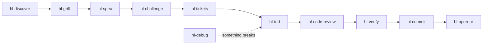

<div align="center">

# hl-skills

### Your coding agent says "done". Make it prove it.

26 agent skills for Claude Code, Codex, Cursor, Gemini CLI, GitHub Copilot, OpenCode, and any agent that reads `SKILL.md`.

[](https://skills.sh/HugoLopes45/hl-skills)
[](https://github.com/HugoLopes45/hl-skills/actions/workflows/ci.yml)
[](./CHANGELOG.md)
[](./LICENSE)

```bash
npx skills add HugoLopes45/hl-skills
```

</div>

---

## Quick start

1. Install: `npx skills add HugoLopes45/hl-skills`. The CLI finds your agents and asks which skills you want.
2. Talk to your agent as usual: *"Why does this test fail?"* The matching skill loads by itself.
3. Or call one by name: *"use hl-code-review on this branch"*, `/hl-code-review` in Claude Code, `$hl-code-review` in Codex. [Each agent](#your-agent) has its own syntax.

That is all. No config, no server, no API key.

## Examples

Real answers from the skills, trimmed with `[...]` and wrapped to fit.

### "Why does this test fail?"

> test_report.py passes when I run it alone but fails in the full suite, and CI is red. Something in test_report must be wrong. Find out what.

`hl-debug` does not trust the guess. It finds the test that pollutes the other one, proves it, and leaves your files untouched:

<details open>
<summary>Answer</summary>

````
Status: defect proven. test_report.py is fine. The bug is in invoice.py,
and it's a production bug as well as a test problem.

Call path:
test_invoice.py:9  render(..., locale="de")
└─ invoice.py:13   settings = get_settings()   -> shared cached dict
   └─ invoice.py:15  settings.update(LOCALES[locale], ...)   <- DEFECT: mutates shared state
test_report.py:6   render_total(orders)
└─ report.py:8     get_settings()  -> returns the mutated dict -> "1.234,50"

| Test order                                  | Result   |
| test_customer_locale, then test_report      | fails    |
| test_report, then test_invoice              | 3 passed |
| [...]                                       |          |
| Full suite, with only line 13 changed       | 6 passed |

Impact: In production, the first invoice rendered with a customer locale
switches every later internal report and default-locale invoice in that
process to that locale. [...]

I haven't edited the repo. Want me to apply the fix with that regression test?
````

</details>

### "Find it and fix it"

> `./run.sh --retries 5` gives up after 4 attempts instead of 6. The retry loop in client.py must be off by one. Find the cause and fix it.

Ask for the fix and `hl-debug` writes a failing test first, then the smallest change:

<details>
<summary>Answer</summary>

````
Status: defect proven and fixed. The retry loop in client.py isn't off by one.
The bug was in the config precedence.

Cause: config.resolve (config.py:9-15) applied --retries first, then
APP_RETRIES from the environment, which overwrote it. run.sh exports
APP_RETRIES=3, so --retries 5 was silently replaced by 3.

Tests:
- I added test_config.py. Before the fix, test_cli_overrides_env failed with assert 3 == 5.
- After the fix, all 3 tests pass.
- ./run.sh --retries 5 now makes 6 attempts.

The same bug affected --timeout and is fixed by the same change.
````

</details>

### "Poke holes in this plan"

> Poke holes in plan.md before I build it.

`hl-challenge` checks each claim of the plan against your code:

<details>
<summary>Answer</summary>

````
fix first. Claim 2 is contradicted by admin.py, so the cache as planned
would serve stale prices. [...]

Blockers
- "Prices never change after a product is created, so no invalidation"
  (plan.md:6): contradicted. admin.py:4-6: set_sale_price runs
  UPDATE prices SET price_cents = ?. Its docstring says it is called by the
  nightly promotions job and by the admin UI.
- lru_cache on get_price is correct across the deployment: contradicted.
  admin.py runs in a different process from the web workers [...], so no
  in-process cache_clear can reach the workers' caches.

Decides the goal: that removing the 250 ms gets the page under 100 ms.
350 - 250 = 100 ms, which is not under 100 ms. [...]

Decisions for you
- How stale may a price be? I recommend at most 60 seconds, because sale
  start and end times need to show up quickly, but not instantly. [...]
````

</details>

### "Review this branch"

> Review this branch against origin/main.

`hl-code-review` gives each finding a location, a trigger, and what it breaks:

<details>
<summary>Answer</summary>

````
Verdict: Fix 1 S1 finding (ratio swallows every exception and returns 0).
| S1 | calc.py:4-5 | except Exception: return 0 hides every error [...] |
| S2 | greet.py:2  | greet("") does not raise ValueError as spec.md item 2 requires |
Trigger: ratio(1, 0), ratio("a", 2) or ratio(None, 1). [...]
Not run: tests, and --deep, --cold and --spec.
````

</details>

## The loop



Use any skill alone, or chain them:

- **Idea to pull request:** `hl-grill`, `hl-spec`, `hl-challenge`, `hl-tdd` for each behavior, `hl-code-review`, `hl-verify`, `hl-commit`, `hl-open-pr`.
- **Production bug:** `hl-debug` to prove the cause, then ask it for the fix.
- **Before a risky merge:** `hl-code-review --deep`, then `hl-deslop`.
- **Inherited codebase:** `hl-discover --depth full`, then `hl-improve arch`, then `hl-improve`.
- **Startup idea:** `hl-startup scout` without an idea, `hl-startup` to evaluate one, `hl-startup ship` or `hl-startup kill` after launch.

## All 26 skills

Every name starts with `hl-`, so no skill replaces a command your agent ships with, such as `/debug` in Claude Code.

### Build

| Say | Skill | You get |
|---|---|---|
| "Where do I start in this repo?" | `hl-discover` | Purpose, stack, git state, and the real build and test commands; `--scope` maps one area |
| "Grill me on the export idea" | `hl-grill` | Rounds of questions, each with a recommended answer; `--gaps` lists what a spec leaves unsaid |
| "Plan the export feature" | `hl-spec` | Scope, acceptance criteria, assumptions, failure scenarios; `--prd` writes a full product spec |
| "Poke holes in this plan" | `hl-challenge` | Each claim checked against code: proceed, fix first, or stop; `--premortem`, `--lens`, [`--panel`](./skills/hl-challenge/references/lenses.md) |
| "Build it test-first" | `hl-tdd` | A test that fails for the right reason, then the smallest change |
| "Why does this fail?" | `hl-debug` | The cause, proven; on request, the fix behind a regression test |
| "Review this branch" | `hl-code-review` | Findings with location, trigger, and consequence; `--deep` adds parallel reviewers |
| "Clean up this AI-written diff" | `hl-deslop` | Slop and invented APIs removed from the change |
| "Are we done?" | `hl-verify` | One row per request: passed, failed, unverified, or blocked |
| "Commit this" | `hl-commit` | A message written from the staged diff, then the commit |
| "Open a PR" | `hl-open-pr` | A draft pull request with why, changes, verification, and risks |
| "Save where we are" | `hl-checkpoint` | Decisions and next action before a context reset; `--stuck` breaks a loop |

### Decide and explain

| Say | Skill | You get |
|---|---|---|
| "Show me how auth works" | `hl-show-me` | A diagram, a tree, pseudocode, or an interactive HTML page |
| "Make a short video explaining CRDTs" | `hl-explainer-video` (experimental) | A narrated explainer video, with a local voice by default |
| "Can SQLite handle our write load?" | `hl-spike` | A time-boxed experiment that answers one question |
| "Write an ADR for moving to Postgres" | `hl-adr` | A decision record with options and the cost of reversal |

### Audit

| Say | Skill | You get |
|---|---|---|
| "Audit this app for security issues" | `hl-security-audit` | Untrusted input traced to dangerous sinks, scored by CWE and CVSS |
| "What should we fix first?" | `hl-improve` | Ranked fixes as plans another agent can run; `arch` and `refactor` modes |

### Ship

| Say | Skill | You get |
|---|---|---|
| "Split this into tickets" | `hl-tickets` | End-to-end slices, one pull request each; `--tracker` for Jira, Linear, GitHub, GitLab |
| "This PR is too big" | `hl-split-pr` | Smaller pull requests in dependency order |
| "CI is red" | `hl-ci-fix` | Failing checks fixed without weakening tests or CI |
| "Handle these review comments" | `hl-receive-review` | Agree, defer, disagree, or clarify for each comment |
| "What did we learn here?" | `hl-lessons` | Checks, rules, or pointers, cheapest first |
| "Write a skill for our deploy process" | `hl-writing-for-agents` | The shortest prompt or skill that gets the behavior |

### Product

| Say | Skill | You get |
|---|---|---|
| "Is this startup idea worth it?" | `hl-startup` | Problem, competition, first customers, MVP test: go, pivot, or stop |
| "Write our launch page" | `hl-launch-marketing` | Positioning, landing copy, launch plan, channels, pricing |

## Install, update, remove

The installer is the [`skills`](https://github.com/vercel-labs/skills) CLI. Commands below were run with v1.7.2.

```bash
# Install
npx skills add HugoLopes45/hl-skills                        # pick skills and agents interactively
npx skills add HugoLopes45/hl-skills --list                 # see the 26 skills first
npx skills add HugoLopes45/hl-skills -s hl-debug -s hl-tdd  # only some skills
npx skills add HugoLopes45/hl-skills -a claude-code -a codex # only some agents
npx skills add HugoLopes45/hl-skills -g                     # for every project (global)
npx skills use HugoLopes45/hl-skills@hl-tdd                 # print one skill as a prompt, install nothing

# Manage (add -g for global skills)
npx skills list                     # what is installed, and for which agents
npx skills update hl-debug hl-tdd   # update these skills
npx skills remove -s hl-tdd         # remove one skill
npx skills remove --all             # remove every skill
```

`npx skills update` without names updates every skill in that scope, from every source, not only this repo.

### Pin a version

Releases follow semantic versioning. A major version renames or removes a skill, or changes how one is invoked. Skills marked experimental are outside this promise and may change in any release. See [CHANGELOG.md](./CHANGELOG.md).

```bash
npx skills add HugoLopes45/hl-skills#v1.0.0              # every skill at v1.0.0
npx skills add HugoLopes45/hl-skills#v1.0.0@hl-tdd       # one skill at v1.0.0
```

`npx skills update` keeps a pinned skill at its tag. To move to another version, run `add` again with the new tag.

### Project or global

| | Project (default) | Global (`-g`) |
|---|---|---|
| Files | `.agents/skills/<name>/` | `~/.agents/skills/<name>/` |
| Claude Code | symlink in `.claude/skills/` | symlink in `~/.claude/skills/` |
| Applies to | this repository | every project on this machine |
| Record | `skills-lock.json` (source and hash) | `~/.agents/.skill-lock.json` |

Use `--copy` for real copies instead of symlinks.

### Share with your team

Commit `.agents/skills/`, `.claude/skills/`, and `skills-lock.json`. A fresh clone then has every skill in every agent, with no install step. Run `npx skills update` to pull new versions, then commit.

`npx skills experimental_install` rebuilds `.agents/skills/` from `skills-lock.json`. It does not create the `.claude/skills/` symlinks, so Claude Code sees nothing after it.

### Your agent

Each agent reads skills from its own folders. Links go to the official docs.

| Agent | Project folder | Global folder | Call a skill | Reload | Checked |
|---|---|---|---|---|---|
| [Claude Code](https://code.claude.com/docs/en/skills) | `.claude/skills/` | `~/.claude/skills/` | `/hl-debug` | `/reload-skills` | 2.1.295 |
| [Codex](https://developers.openai.com/codex/skills) | `.agents/skills/` | `~/.agents/skills/` | `$hl-debug` or `/skills` | restart | 0.162.1 |
| [Cursor](https://cursor.com/docs/skills) | `.agents/skills/` | `~/.agents/skills/` | `/hl-debug` in Agent chat | restart | docs only |
| [Gemini CLI](https://geminicli.com/docs/cli/skills/) | `.agents/skills/` | `~/.agents/skills/` | by description | `/skills reload` | 0.63.0 |
| [GitHub Copilot CLI](https://docs.github.com/en/copilot/how-tos/copilot-cli/customize-copilot/add-skills) | `.agents/skills/` | `~/.agents/skills/` | `/hl-debug` | `/skills reload` | 1.0.14 |
| [OpenCode](https://opencode.ai/docs/skills/) | `.agents/skills/` | `~/.agents/skills/` | by description | restart | 1.19.0 |
| [Pi](https://github.com/earendil-works/pi/blob/main/packages/coding-agent/docs/skills.md) | `.agents/skills/` | `~/.agents/skills/` | `/skill:hl-debug` | `/reload` | 1.2.0 |

"Checked": the version that loaded skills from both folders in a test on macOS.

### If a skill does not show up

- **Claude Code**: a personal skill or a `~/.claude/commands/<name>.md` file with the same name wins over the project skill. Rename or remove it, then check with `/skills`.
- **Gemini CLI and Pi**: project skills load only in a trusted folder. Accept the trust prompt.
- **Gemini CLI**: needs a recent version. 0.17 has no `gemini skills` command; 0.63.0 works.
- **Any agent**: start a new session after you install.

Skills run with your agent's full permissions. Read a skill before you install it.

## Contributing

Read [CONTRIBUTING.md](./CONTRIBUTING.md) and [STYLE.md](./STYLE.md). `python3 scripts/validate.py` checks each skill; [evals/](./evals/README.md) runs them against a real agent. Report vulnerabilities as [SECURITY.md](./SECURITY.md) describes.

## License

[MIT](./LICENSE)
