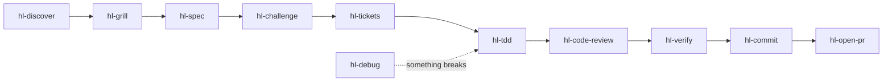

<div align="center">

# hl-skills

### Build something worth shipping.

27 skills for your coding agent, from questioning an idea to debugging a failure to shaping a launch. For Claude Code, Codex, Cursor, Gemini CLI, GitHub Copilot, OpenCode, Pi, and any agent that reads `SKILL.md`.

**[Install](#install)** · [Find your next move](#find-your-next-move) · [The lifecycle](#the-lifecycle) · [Real answers](#real-answers) · [Update, remove, pin](#update-remove-pin) · [Questions](#questions)

[](https://github.com/HugoLopes45/hl-skills/actions/workflows/ci.yml)
[](./CHANGELOG.md)
[](./LICENSE)

</div>

## Install

```bash
npx skills add HugoLopes45/hl-skills
```

Run it in your project and follow the installer. Requires Node.js 22.20+ and npm.

Add `--global` for a user-level install. No config, no server, no API key.

## Find your next move

Open a fresh agent session. Pick a skill and adapt its example to your task. Skills also load by themselves when your request matches one, such as *"Why does this test fail?"*

| Skill | Try asking your agent |
|---|---|
| [hl-discover](./skills/hl-discover/SKILL.md) | `Use hl-discover to map this repo and show me where to start.` |
| [hl-grill](./skills/hl-grill/SKILL.md) | `Use hl-grill to compare magic links and passwords for this app.` |
| [hl-spec](./skills/hl-spec/SKILL.md) | `Use hl-spec to plan CSV exports with clear acceptance criteria.` |
| [hl-challenge](./skills/hl-challenge/SKILL.md) | `Use hl-challenge to find the weak assumptions in this plan.` |
| [hl-tdd](./skills/hl-tdd/SKILL.md) | `Use hl-tdd to reject expired invitations, test first.` |
| [hl-debug](./skills/hl-debug/SKILL.md) | `Use hl-debug to find why this test fails only in the full suite.` |
| [hl-code-review](./skills/hl-code-review/SKILL.md) | `Use hl-code-review to review this branch for bugs and regressions.` |
| [hl-deslop](./skills/hl-deslop/SKILL.md) | `Use hl-deslop to remove unnecessary abstractions from this diff.` |
| [hl-verify](./skills/hl-verify/SKILL.md) | `Use hl-verify to check this change against its acceptance criteria.` |
| [hl-commit](./skills/hl-commit/SKILL.md) | `Use hl-commit to commit the staged changes.` |
| [hl-open-pr](./skills/hl-open-pr/SKILL.md) | `Use hl-open-pr to open a draft PR for this branch.` |
| [hl-checkpoint](./skills/hl-checkpoint/SKILL.md) | `Use hl-checkpoint to prepare a handoff before I start a fresh session.` |
| [hl-ambitious](./skills/hl-ambitious/SKILL.md) | `Use hl-ambitious to make this task deeper without expanding its scope.` |
| [hl-show-me](./skills/hl-show-me/SKILL.md) | `Use hl-show-me to draw how authentication works in this app.` |
| [hl-explainer-video](./skills/hl-explainer-video/SKILL.md) (experimental) | `Use hl-explainer-video to make a short narrated video explaining CRDTs.` |
| [hl-spike](./skills/hl-spike/SKILL.md) | `Use hl-spike to test whether SQLite can handle our write load.` |
| [hl-adr](./skills/hl-adr/SKILL.md) | `Use hl-adr to record why we chose PostgreSQL and the cost of reversing it.` |
| [hl-security-audit](./skills/hl-security-audit/SKILL.md) | `Use hl-security-audit to audit our password-reset flow for account-takeover risks.` |
| [hl-improve](./skills/hl-improve/SKILL.md) | `Use hl-improve to prioritize what we should fix in this codebase.` |
| [hl-tickets](./skills/hl-tickets/SKILL.md) | `Use hl-tickets to turn this feature plan into independently testable tickets.` |
| [hl-split-pr](./skills/hl-split-pr/SKILL.md) | `Use hl-split-pr to plan smaller PRs from this oversized diff.` |
| [hl-ci-fix](./skills/hl-ci-fix/SKILL.md) | `Use hl-ci-fix to fix the failing checks on this PR.` |
| [hl-receive-review](./skills/hl-receive-review/SKILL.md) | `Use hl-receive-review to evaluate these review comments before we make changes.` |
| [hl-lessons](./skills/hl-lessons/SKILL.md) | `Use hl-lessons to turn what we learned from this bug into a durable safeguard.` |
| [hl-writing-for-agents](./skills/hl-writing-for-agents/SKILL.md) | `Use hl-writing-for-agents to make this prompt shorter without losing its requirements.` |
| [hl-startup](./skills/hl-startup/SKILL.md) | `Use hl-startup to pressure-test this SaaS idea before I build it.` |
| [hl-launch-marketing](./skills/hl-launch-marketing/SKILL.md) | `Use hl-launch-marketing to turn this README into a landing page.` |

## The lifecycle



Use any skill alone, or chain them:

- **Idea to pull request:** `hl-grill`, `hl-spec`, `hl-challenge`, `hl-tdd` for each behavior, `hl-code-review`, `hl-verify`, `hl-commit`, `hl-open-pr`.
- **Production bug:** `hl-debug` to prove the cause, then ask it for the fix.
- **Before a risky merge:** `hl-code-review --deep`, then `hl-deslop`.
- **Inherited codebase:** `hl-discover --depth full`, then `hl-improve arch`, then `hl-improve`.
- **Startup idea:** `hl-startup scout` without an idea, `hl-startup` to evaluate one, `hl-startup ship` or `hl-startup kill` after launch.

## Real answers

Answers from the skills, trimmed with `[...]` and wrapped to fit.

### "Why does this test fail?"

> test_report.py passes when I run it alone but fails in the full suite, and CI is red. Something in test_report must be wrong. Find out what.

`hl-debug` does not trust the guess. It finds the test that pollutes the other one, proves it, and leaves your files untouched:

<details>
<summary>Answer</summary>

````
**`test_report.py` is correct. `invoice.py:15` changes the shared settings that
`get_settings()` returns, so every later test sees German formatting.**

Any code that runs after an invoice is rendered with a locale gets the wrong
separators. In production, `report.render_total` would show `1.234,50 EUR` for the
internal report once a German invoice had been rendered in the same process. [...] I
did not edit your tree; the toggle ran in a temporary copy.

1. **Where it goes wrong.** `get_settings()` is cached with `lru_cache`, so every
   caller gets the same dict object. `invoice.render` updates that dict in place when
   a locale is passed.
   ```text
   test_invoice.py:9   test_customer_locale       # runs first, passes
   `-- invoice.py:13   settings = get_settings()  # the cached dict, not a copy
       `-- invoice.py:15  settings.update(...)    # changes it for the whole process
   test_report.py:6    test_report_total          # fails: '1.234,50 EUR'
   `-- report.py:8     get_settings()             # returns the changed dict
   ```

2. **The trigger and the defect are different things.** The trigger is test order: in
   the full suite `test_invoice.py` runs before `test_report.py`. The defect is the
   in-place change of the cached dict. Two-test runs show it:
   ```text
   test_customer_locale + test_report      1 failed, 1 passed
   test_default_invoice + test_report      2 passed   (no locale, no change)
   full suite, as shipped                  1 failed, 5 passed
   full suite, only line 13 -> dict(...)   6 passed
   ```
[...]

Verdict: Defect proven

**Next:**
1. Add a regression test that calls `render([("W", 1)], locale="de")` and then asserts
   `get_settings()["decimal_sep"] == "."`. It should fail now.
2. Change `invoice.py:13` to `settings = dict(get_settings())`. Then rerun the full
   suite.

Do you want me to make that fix? (default: yes)
````

</details>

### "Find it and fix it"

> `./run.sh --retries 5` gives up after 4 attempts instead of 6. The retry loop in client.py must be off by one. Find the cause and fix it.

Ask for the fix and `hl-debug` writes a failing test first, then the smallest change:

<details>
<summary>Answer</summary>

````
**Fixed: `--retries 5` was overridden by the `APP_RETRIES=3` that `run.sh` sets,
because `config.py:13-15` applied the environment after the command line.**

The retry loop in `client.py` is correct. It makes 1 + `retries` attempts, so
`retries=3` gives 4 attempts, which matches what you saw. Every command-line
`--retries` and `--timeout` passed through `./run.sh` was silently ignored. [...]

1. **Where it goes wrong:**
   ```text
   run.sh:4              exports APP_RETRIES=3          # the trigger
   app.py:13             config.resolve(args)
   `-- config.py:10-15   cli applied first, then env    # env overwrites cli
   app.py:15             call_with_retries(..., 3)
   `-- client.py:4       range(1, retries + 2)          # correct: 4 attempts
   ```
[...]

```text
test_cli_overrides_env   before: fail (3 != 5)          after: pass
full suite               before: 1 failed, 2 passed     after: 3 passed
./run.sh --retries 5     before: 4 attempts             after: 6 attempts
```
No debug markers remain.

Verdict: Defect proven (fixed)

**Next:** Review and commit. I haven't committed anything.

**Changed:** `config.py`, `test_config.py` (new)
````

</details>

### "Poke holes in this plan"

> Poke holes in plan.md before I build it.

`hl-challenge` checks each claim of the plan against your code:

<details>
<summary>Answer</summary>

````
**Prices do change after creation, so the cache would show stale prices until
restart.**

I checked `plan.md` (goal: product pages under 100 ms, down from 350 ms) against
`prices.py`, `admin.py` and `db.py`. [...] I ran nothing because `db.py` only raises
`NotImplementedError`.

1. **The plan's "prices never change" claim is wrong, and the cache would serve
   outdated prices.**
   After a sale starts or ends, pages keep showing the old price until the process
   restarts. Each worker process also holds its own cache, so different servers would
   show different prices.
   ```text
   plan.md:6    "Prices never change after a product is created"
   admin.py:4   set_sale_price(sku, cents)  # nightly promotions job, admin UI
   admin.py:6   UPDATE prices SET price_cents = ? ...
   ```
   Fix: don't build with "no invalidation". Either use a short expiry (TTL, a time
   limit per entry) or clear the entry when a price changes.

Risks:
1. The 100 ms goal is probably met only on cache hits. [...] The plan has no hit rate
   and no measurement, so this is untested, and it decides the goal.
[...]

Smaller version:
```diff
~ step 1: cache get_price with a short TTL (e.g. 60 s), not an unbounded lru_cache
- step 2: "no invalidation needed" (false; set_sale_price changes prices)
~ step 3: also test that a price change shows up within the TTL
```

Verdict: Fix first

**Next:**
1. Replace step 2 with an expiry or invalidation design. Add a test that
   `set_sale_price` followed by `get_price` returns the new price within the allowed
   delay.
[...]
3. Decide: how stale may a price be? Recommended: 60 seconds or less.
````

</details>

### "Review this branch"

> Review this branch against origin/main.

`hl-code-review` gives each finding a location, a trigger, and what it breaks:

<details>
<summary>Answer</summary>

````
**`ratio` now returns 0 for any error, so a zero divisor looks like a real result of
0.**

I compared the merge base `c5966d1` (which is `origin/main`) with `f8cc554`.
`origin/main` is a local remote-tracking ref and I did not fetch it, so it is
unchecked. [...] I also treated `spec.md` as the requirements.

1. **`ratio` hides every failure behind a 0, a material bug.**
   `except Exception: return 0` at `calc.py:4-5` catches more than division by zero.
   `ratio(1, 0)` returns 0, which is also the correct answer for `ratio(0, 5)`, so
   callers can't tell an error from a real result. [...]
   ```text
   calc.py:2   try:
   calc.py:3       return a / b
   calc.py:4   except Exception:   # also catches TypeError and others
   calc.py:5       return 0        # same value as a real 0 result
   ```

2. **`greet("")` returns "Hello, !" instead of raising `ValueError`, a material bug.**
   Spec line 2 says `greet("")` raises `ValueError`. `greet` at `greet.py:2` has no
   check. This requirement is missing from the diff. I'm sure of this one.
[...]

Verdict: Fix (2 problems)

**Next:**
1. In `calc.py:4`, replace `except Exception: return 0` with a narrow handler that
   doesn't return 0. Answer one question first: should `ratio(x, 0)` raise (default),
   return `None`, or return 0 on purpose?
2. In `greet.py`, raise `ValueError` for an empty `name`.
[...]
4. Add tests for `greet("")`, `ratio(1, 0)`, and `ratio(None, 2)`.
````

</details>

## Update, remove, pin

The installer is the [`skills`](https://github.com/vercel-labs/skills) CLI. Commands below were run with v1.7.2.

```bash
# Install
npx skills add HugoLopes45/hl-skills                        # pick skills and agents interactively
npx skills add HugoLopes45/hl-skills --list                 # see the 27 skills first
npx skills add HugoLopes45/hl-skills -s hl-debug -s hl-tdd  # only some skills
npx skills add HugoLopes45/hl-skills -a claude-code -a codex # only some agents
npx skills add HugoLopes45/hl-skills -g                     # for every project (global)
npx skills use HugoLopes45/hl-skills@hl-tdd                 # print one skill as a prompt, install nothing

# Manage (add -g for global skills)
npx skills list                     # what is installed, and for which agents
npx skills update hl-debug hl-tdd   # update these skills
npx skills remove -s hl-tdd         # remove one skill
npx skills remove --all             # remove every skill
```

`npx skills update` without names updates every skill in that scope, from every source, not only this repo.

### Pin a version

Releases follow semantic versioning. A major version renames or removes a skill, or changes how one is invoked. Skills marked experimental are outside this promise and may change in any release. See [CHANGELOG.md](./CHANGELOG.md).

```bash
npx skills add HugoLopes45/hl-skills#v1.0.0              # every skill at v1.0.0
npx skills add HugoLopes45/hl-skills#v1.0.0@hl-tdd       # one skill at v1.0.0
```

`npx skills update` keeps a pinned skill at its tag. To move to another version, run `add` again with the new tag.

### Project or global

| | Project (default) | Global (`-g`) |
|---|---|---|
| Files | `.agents/skills/<name>/` | `~/.agents/skills/<name>/` |
| Claude Code | symlink in `.claude/skills/` | symlink in `~/.claude/skills/` |
| Applies to | this repository | every project on this machine |
| Record | `skills-lock.json` (source and hash) | `~/.agents/.skill-lock.json` |

Use `--copy` for real copies instead of symlinks.

### Share with your team

Commit `.agents/skills/`, `.claude/skills/`, and `skills-lock.json`. A fresh clone then has every skill in every agent, with no install step. Run `npx skills update` to pull new versions, then commit.

`npx skills experimental_install` rebuilds `.agents/skills/` from `skills-lock.json`. It does not create the `.claude/skills/` symlinks, so Claude Code sees nothing after it.

## Questions

<details>
<summary><b>How do I call a skill in my agent?</b></summary>

Each agent reads skills from its own folders. Links go to the official docs.

| Agent | Project folder | Global folder | Call a skill | Reload | Checked |
|---|---|---|---|---|---|
| [Claude Code](https://code.claude.com/docs/en/skills) | `.claude/skills/` | `~/.claude/skills/` | `/hl-debug` | `/reload-skills` | 2.1.295 |
| [Codex](https://developers.openai.com/codex/skills) | `.agents/skills/` | `~/.agents/skills/` | `$hl-debug` or `/skills` | restart | 0.162.1 |
| [Cursor](https://cursor.com/docs/skills) | `.agents/skills/` | `~/.agents/skills/` | `/hl-debug` in Agent chat | restart | docs only |
| [Gemini CLI](https://geminicli.com/docs/cli/skills/) | `.agents/skills/` | `~/.agents/skills/` | by description | `/skills reload` | 0.63.0 |
| [GitHub Copilot CLI](https://docs.github.com/en/copilot/how-tos/copilot-cli/customize-copilot/add-skills) | `.agents/skills/` | `~/.agents/skills/` | `/hl-debug` | `/skills reload` | 1.0.14 |
| [OpenCode](https://opencode.ai/docs/skills/) | `.agents/skills/` | `~/.agents/skills/` | by description | restart | 1.19.0 |
| [Pi](https://github.com/earendil-works/pi/blob/main/packages/coding-agent/docs/skills.md) | `.agents/skills/` | `~/.agents/skills/` | `/skill:hl-debug` | `/reload` | 1.2.0 |

"Checked": the version that loaded skills from both folders in a test on macOS.

</details>

<details>
<summary><b>A skill does not show up. What now?</b></summary>

- **Claude Code**: a personal skill or a `~/.claude/commands/<name>.md` file with the same name wins over the project skill. Rename or remove it, then check with `/skills`.
- **Gemini CLI and Pi**: project skills load only in a trusted folder. Accept the trust prompt.
- **Gemini CLI**: needs a recent version. 0.17 has no `gemini skills` command; 0.63.0 works.
- **Any agent**: start a new session after you install.

</details>

<details>
<summary><b>Will a skill replace my agent's own commands?</b></summary>

No. Every name starts with `hl-`, so no skill replaces a command your agent ships with, such as `/debug` in Claude Code.

</details>

<details>
<summary><b>Is it safe?</b></summary>

Skills run with your agent's full permissions. Read a skill before you install it. Report vulnerabilities as [SECURITY.md](./SECURITY.md) describes.

</details>

<details>
<summary><b>Is it production-ready?</b></summary>

Qualification is in progress. Installation and static checks do not establish production readiness. See the [qualification criteria and remaining failures](./evals/README.md#production-qualification).

</details>

<details>
<summary><b>How do I contribute?</b></summary>

Read [CONTRIBUTING.md](./CONTRIBUTING.md) and [STYLE.md](./STYLE.md). `python3 scripts/validate.py` checks each skill; [evals/](./evals/README.md) runs them against a real agent.

</details>

---

[Contribute](./CONTRIBUTING.md) · [Security](./SECURITY.md) · [MIT](./LICENSE)
