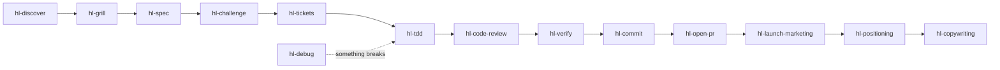

<div align="center">

# hl-skills

### 把东西做对，再让人找到它。

**50 个技能，为你的编程智能体配上一支工程团队和一支增长团队。**

质疑想法。先写测试。证明缺陷。交付拉取请求。

找到切入点。写好页面。规划测试。读懂数据。

适用于 Claude Code、Codex、Cursor、Gemini CLI、GitHub Copilot、OpenCode、Pi，以及任何读取 `SKILL.md` 的智能体。

**[安装](#install)** · [带来一个真实问题](#bring-a-real-problem) · [找到下一步](#find-your-next-move) · [查看真实回答](#real-answers) · [实测，而非承诺](#measured-not-promised) · [常见问题](#questions) · [English](./README.md)

[](https://github.com/HugoLopes45/hl-skills/actions/workflows/ci.yml)
[](./CHANGELOG.md)
[](./LICENSE)

</div>

[English](./README.md)。如果中英文内容不一致，以英文版为准。

你的智能体写得很快。它也可能靠猜、过早地附和你，并用它并不掌握的证据填补空白。每个技能都为一项工作提供一套经过测试的方法，并要求它拿出证据：文件和行号、测试运行、来源，或者在缺少证据的地方留下可见的占位符。

<a id="install"></a>

## 安装

```bash
npx skills add HugoLopes45/hl-skills
```

在你的项目中运行，然后按安装程序操作。需要 Node.js 22.20+ 和 npm。无需配置，无需服务器，无需 API 密钥。

添加 `--global` 进行用户级安装。只想要其中一部分？用 `-s` 选择技能，例如 `-s hl-debug -s hl-tdd` 或 `-s hl-positioning -s hl-copywriting`。

然后打开一个新的智能体会话，并提出请求：

> Use hl-debug to find why this test fails only in the full suite.

<a id="bring-a-real-problem"></a>

## 带来一个真实问题

**你的测试单独运行时通过，在完整套件中失败。** [hl-debug](./skills/hl-debug/SKILL.md) 在改动任何一行之前，先证明是哪个测试污染了另一个。要求修复时，它会先写出失败的测试。

**你有一个想法和一个空白的编辑器。** [hl-grill](./skills/hl-grill/SKILL.md) 提出你跳过的问题，[hl-spec](./skills/hl-spec/SKILL.md) 把答案变成验收标准，[hl-challenge](./skills/hl-challenge/SKILL.md) 对照你的代码检查计划中的每一条论断。

**你的分支准备合并了。** [hl-code-review](./skills/hl-code-review/SKILL.md) 为每个发现给出位置、触发条件以及它会破坏什么。[hl-verify](./skills/hl-verify/SKILL.md) 对照你的要求检查这次变更。

**你有一个产品。让人清楚为什么选它。** [hl-positioning](./skills/hl-positioning/SKILL.md) 梳理你的买家证据，然后 [hl-copywriting](./skills/hl-copywriting/SKILL.md) 把信息写到页面上。

**你有值得说的内容。决定它该放在哪里。** [hl-keyword-research](./skills/hl-keyword-research/SKILL.md) 从你的导出数据中选出一个搜索主题，然后 [hl-content-brief](./skills/hl-content-brief/SKILL.md) 为写作者指明方向。

**你有一个页面。找出访问和下一步之间的障碍。** [hl-page-cro-audit](./skills/hl-page-cro-audit/SKILL.md) 指出阻力所在，然后 [hl-ab-test-plan](./skills/hl-ab-test-plan/SKILL.md) 规定如何测试一项改动。

每个技能都可以单独运行，也可以把输出交给下一个技能。当你的请求与某个技能匹配时，技能也会自动加载，例如 *"Why does this test fail?"*。这些是由你掌控的工作流，而不是一个自主运行的团队。

<a id="find-your-next-move"></a>

## 找到下一步

十一个部门。选择你眼前的工作，复制一个提示词，并把其中的示例换成你自己的代码、简报、页面或导出数据。

### 工程

<details>
<summary><strong>思考 · 在想法耗掉一个迭代之前，淘汰坏想法</strong> · 6 个技能</summary>

| 技能 | 给你的智能体派一项工作 |
|---|---|
| [hl-discover](./skills/hl-discover/SKILL.md) | `Use hl-discover to map this repo and show me where to start.` |
| [hl-grill](./skills/hl-grill/SKILL.md) | `Use hl-grill to compare magic links and passwords for this app.` |
| [hl-spec](./skills/hl-spec/SKILL.md) | `Use hl-spec to plan CSV exports with clear acceptance criteria.` |
| [hl-challenge](./skills/hl-challenge/SKILL.md) | `Use hl-challenge to find the weak assumptions in this plan.` |
| [hl-spike](./skills/hl-spike/SKILL.md) | `Use hl-spike to test whether SQLite can handle our write load.` |
| [hl-adr](./skills/hl-adr/SKILL.md) | `Use hl-adr to record why we chose PostgreSQL and the cost of reversing it.` |

</details>

<details>
<summary><strong>构建 · 先写测试，保持代码精简</strong> · 6 个技能</summary>

| 技能 | 给你的智能体派一项工作 |
|---|---|
| [hl-tdd](./skills/hl-tdd/SKILL.md) | `Use hl-tdd to reject expired invitations, test first.` |
| [hl-tickets](./skills/hl-tickets/SKILL.md) | `Use hl-tickets to turn this feature plan into independently testable tickets.` |
| [hl-ambitious](./skills/hl-ambitious/SKILL.md) | `Use hl-ambitious to make this task deeper without expanding its scope.` |
| [hl-show-me](./skills/hl-show-me/SKILL.md) | `Use hl-show-me to draw how authentication works in this app.` |
| [hl-explainer-video](./skills/hl-explainer-video/SKILL.md) (experimental) | `Use hl-explainer-video to make a short narrated video explaining CRDTs.` |
| [hl-writing-for-agents](./skills/hl-writing-for-agents/SKILL.md) | `Use hl-writing-for-agents to make this prompt shorter without losing its requirements.` |

</details>

<details>
<summary><strong>修复 · 动代码之前先证明原因</strong> · 5 个技能</summary>

| 技能 | 给你的智能体派一项工作 |
|---|---|
| [hl-debug](./skills/hl-debug/SKILL.md) | `Use hl-debug to find why this test fails only in the full suite.` |
| [hl-ci-fix](./skills/hl-ci-fix/SKILL.md) | `Use hl-ci-fix to fix the failing checks on this PR.` |
| [hl-security-audit](./skills/hl-security-audit/SKILL.md) | `Use hl-security-audit to audit our password-reset flow for account-takeover risks.` |
| [hl-improve](./skills/hl-improve/SKILL.md) | `Use hl-improve to prioritize what we should fix in this codebase.` |
| [hl-lessons](./skills/hl-lessons/SKILL.md) | `Use hl-lessons to turn what we learned from this bug into a durable safeguard.` |

</details>

<details>
<summary><strong>交付 · 合并你能为之辩护的工作</strong> · 8 个技能</summary>

| 技能 | 给你的智能体派一项工作 |
|---|---|
| [hl-code-review](./skills/hl-code-review/SKILL.md) | `Use hl-code-review to review this branch for bugs and regressions.` |
| [hl-receive-review](./skills/hl-receive-review/SKILL.md) | `Use hl-receive-review to evaluate these review comments before we make changes.` |
| [hl-deslop](./skills/hl-deslop/SKILL.md) | `Use hl-deslop to remove unnecessary abstractions from this diff.` |
| [hl-verify](./skills/hl-verify/SKILL.md) | `Use hl-verify to check this change against its acceptance criteria.` |
| [hl-commit](./skills/hl-commit/SKILL.md) | `Use hl-commit to commit the staged changes.` |
| [hl-split-pr](./skills/hl-split-pr/SKILL.md) | `Use hl-split-pr to plan smaller PRs from this oversized diff.` |
| [hl-open-pr](./skills/hl-open-pr/SKILL.md) | `Use hl-open-pr to open a draft PR for this branch.` |
| [hl-checkpoint](./skills/hl-checkpoint/SKILL.md) | `Use hl-checkpoint to prepare a handoff before I start a fresh session.` |

</details>

<details>
<summary><strong>发布 · 判断是否值得做，然后告诉世界</strong> · 2 个技能</summary>

| 技能 | 给你的智能体派一项工作 |
|---|---|
| [hl-startup](./skills/hl-startup/SKILL.md) | `Use hl-startup to pressure-test this SaaS idea before I build it.` |
| [hl-launch-marketing](./skills/hl-launch-marketing/SKILL.md) | `Use hl-launch-marketing to turn this README into a landing page.` |

</details>

### 增长与营销

<details>
<summary><strong>策略 · 给人们一个选择你的理由</strong> · 4 个技能</summary>

| 技能 | 给你的智能体派一项工作 |
|---|---|
| [hl-positioning](./skills/hl-positioning/SKILL.md) | `Use hl-positioning to state what this hot sauce should claim, from our five buyer interviews.` |
| [hl-persona](./skills/hl-persona/SKILL.md) | `Use hl-persona to build buyer cards from these six interview notes, with no invented details.` |
| [hl-competitor-analysis](./skills/hl-competitor-analysis/SKILL.md) | `Use hl-competitor-analysis to profile these two rivals from their dated captures.` |
| [hl-pricing](./skills/hl-pricing/SKILL.md) | `Use hl-pricing to propose a plan structure and a test, from our buyer survey.` |

</details>

<details>
<summary><strong>SEO 与 AI 搜索 · 做值得被找到的页面</strong> · 6 个技能</summary>

| 技能 | 给你的智能体派一项工作 |
|---|---|
| [hl-seo-audit](./skills/hl-seo-audit/SKILL.md) | `Use hl-seo-audit to find why this page is blocked from search.` |
| [hl-keyword-research](./skills/hl-keyword-research/SKILL.md) | `Use hl-keyword-research to pick the next page to write from this Search Console export.` |
| [hl-content-brief](./skills/hl-content-brief/SKILL.md) | `Use hl-content-brief to brief a guide on how to chase a late invoice, for freelance designers in the United States.` |
| [hl-ai-search-visibility](./skills/hl-ai-search-visibility/SKILL.md) | `Use hl-ai-search-visibility to check this page for blockers before AI answers quote it.` |
| [hl-schema-markup](./skills/hl-schema-markup/SKILL.md) | `Use hl-schema-markup to check the JSON-LD on this product page against its visible price.` |
| [hl-internal-linking](./skills/hl-internal-linking/SKILL.md) | `Use hl-internal-linking to find orphan pages and broken targets in this links export.` |

</details>

<details>
<summary><strong>文案与邮件 · 说清楚，保留每一个事实</strong> · 5 个技能</summary>

| 技能 | 给你的智能体派一项工作 |
|---|---|
| [hl-copywriting](./skills/hl-copywriting/SKILL.md) | `Use hl-copywriting to rewrite this hero without invented proof.` |
| [hl-article-writing](./skills/hl-article-writing/SKILL.md) | `Use hl-article-writing to turn this brief into a complete article for our publication, in the requested language. Keep every figure sourced.` |
| [hl-de-ai-rewriting](./skills/hl-de-ai-rewriting/SKILL.md) | `Use hl-de-ai-rewriting to make this shipping notice clearer, keeping every date and fee.` |
| [hl-email](./skills/hl-email/SKILL.md) | `Use hl-email to draft a renewal reminder from this brief, with placeholders for any offer we have not supplied.` |
| [hl-email-sequence](./skills/hl-email-sequence/SKILL.md) | `Use hl-email-sequence to map a three-step welcome sequence from these recorded events.` |

</details>

<details>
<summary><strong>转化 · 把访问变成下一步</strong> · 3 个技能</summary>

| 技能 | 给你的智能体派一项工作 |
|---|---|
| [hl-page-cro-audit](./skills/hl-page-cro-audit/SKILL.md) | `Use hl-page-cro-audit to find what blocks booking on this clinic page, and label each hypothesis.` |
| [hl-onboarding](./skills/hl-onboarding/SKILL.md) | `Use hl-onboarding to design the first-week flow for this fitness app from its step list.` |
| [hl-ab-test-plan](./skills/hl-ab-test-plan/SKILL.md) | `Use hl-ab-test-plan to plan a test on this pricing toggle, with sizing from our baseline export.` |

</details>

<details>
<summary><strong>渠道 · 出现在买家已经在的地方</strong> · 3 个技能</summary>

| 技能 | 给你的智能体派一项工作 |
|---|---|
| [hl-social](./skills/hl-social/SKILL.md) | `Use hl-social to draft two captions from this brief. Platform and market are in the brief.` |
| [hl-paid-ads](./skills/hl-paid-ads/SKILL.md) | `Use hl-paid-ads to write three search ad variants from this brief, with missing proof as placeholders.` |
| [hl-short-video](./skills/hl-short-video/SKILL.md) | `Use hl-short-video to turn this brief into a 30-second script for our chosen platform, with spoken lines, shots, on-screen text and rights checks.` |

</details>

<details>
<summary><strong>分析 · 知道下一步该衡量什么</strong> · 2 个技能</summary>

| 技能 | 给你的智能体派一项工作 |
|---|---|
| [hl-tracking-plan](./skills/hl-tracking-plan/SKILL.md) | `Use hl-tracking-plan to plan the events behind this booking decision. Flag personal data.` |
| [hl-reporting](./skills/hl-reporting/SKILL.md) | `Use hl-reporting to summarise this weekly export by channel. Name what is missing.` |

</details>

## 生命周期



常用组合：

- **从想法到拉取请求：** `hl-grill`、`hl-spec`、`hl-challenge`，每个行为用一次 `hl-tdd`，然后 `hl-code-review`、`hl-verify`、`hl-commit`、`hl-open-pr`。
- **生产缺陷：** 用 `hl-debug` 证明原因，然后让它修复。
- **高风险合并之前：** `hl-code-review --deep`，然后 `hl-deslop`。
- **接手的代码库：** `hl-discover --depth full`，然后 `hl-improve arch`，再 `hl-improve`。
- **创业想法：** 没有想法时用 `hl-startup scout`，评估一个想法用 `hl-startup`，发布后用 `hl-startup ship` 或 `hl-startup kill`。
- **从发布到第一批客户：** `hl-launch-marketing`，然后 `hl-positioning`、`hl-copywriting`，并在把钱花在 `hl-paid-ads` 之前先用 `hl-tracking-plan`。

<a id="real-answers"></a>

## 真实回答

以下是技能给出的回答，保留英文原文，用 `[...]` 删减并换行以适应版面。

### "Why does this test fail?"

> test_report.py passes when I run it alone but fails in the full suite, and CI is red. Something in test_report must be wrong. Find out what.

`hl-debug` 不相信猜测。它找出污染另一个测试的那个测试，加以证明，并且不改动你的文件：

<details>
<summary>回答</summary>

````
**`test_report.py` is correct. `invoice.py:15` changes the shared settings that
`get_settings()` returns, so every later test sees German formatting.**

Any code that runs after an invoice is rendered with a locale gets the wrong
separators. In production, `report.render_total` would show `1.234,50 EUR` for the
internal report once a German invoice had been rendered in the same process. [...] I
did not edit your tree; the toggle ran in a temporary copy.

1. **Where it goes wrong.** `get_settings()` is cached with `lru_cache`, so every
   caller gets the same dict object. `invoice.render` updates that dict in place when
   a locale is passed.
   ```text
   test_invoice.py:9   test_customer_locale       # runs first, passes
   `-- invoice.py:13   settings = get_settings()  # the cached dict, not a copy
       `-- invoice.py:15  settings.update(...)    # changes it for the whole process
   test_report.py:6    test_report_total          # fails: '1.234,50 EUR'
   `-- report.py:8     get_settings()             # returns the changed dict
   ```

2. **The trigger and the defect are different things.** The trigger is test order: in
   the full suite `test_invoice.py` runs before `test_report.py`. The defect is the
   in-place change of the cached dict. Two-test runs show it:
   ```text
   test_customer_locale + test_report      1 failed, 1 passed
   test_default_invoice + test_report      2 passed   (no locale, no change)
   full suite, as shipped                  1 failed, 5 passed
   full suite, only line 13 -> dict(...)   6 passed
   ```
[...]

Verdict: Defect proven

**Next:**
1. Add a regression test that calls `render([("W", 1)], locale="de")` and then asserts
   `get_settings()["decimal_sep"] == "."`. It should fail now.
2. Change `invoice.py:13` to `settings = dict(get_settings())`. Then rerun the full
   suite.

Do you want me to make that fix? (default: yes)
````

</details>

### "Find it and fix it"

> `./run.sh --retries 5` gives up after 4 attempts instead of 6. The retry loop in client.py must be off by one. Find the cause and fix it.

要求修复时，`hl-debug` 先写一个失败的测试，再做最小的改动：

<details>
<summary>回答</summary>

````
**Fixed: `--retries 5` was overridden by the `APP_RETRIES=3` that `run.sh` sets,
because `config.py:13-15` applied the environment after the command line.**

The retry loop in `client.py` is correct. It makes 1 + `retries` attempts, so
`retries=3` gives 4 attempts, which matches what you saw. Every command-line
`--retries` and `--timeout` passed through `./run.sh` was silently ignored. [...]

1. **Where it goes wrong:**
   ```text
   run.sh:4              exports APP_RETRIES=3          # the trigger
   app.py:13             config.resolve(args)
   `-- config.py:10-15   cli applied first, then env    # env overwrites cli
   app.py:15             call_with_retries(..., 3)
   `-- client.py:4       range(1, retries + 2)          # correct: 4 attempts
   ```
[...]

```text
test_cli_overrides_env   before: fail (3 != 5)          after: pass
full suite               before: 1 failed, 2 passed     after: 3 passed
./run.sh --retries 5     before: 4 attempts             after: 6 attempts
```
No debug markers remain.

Verdict: Defect proven (fixed)

**Next:** Review and commit. I haven't committed anything.

**Changed:** `config.py`, `test_config.py` (new)
````

</details>

### "Poke holes in this plan"

> Poke holes in plan.md before I build it.

`hl-challenge` 对照你的代码检查计划中的每一条论断：

<details>
<summary>回答</summary>

````
**Prices do change after creation, so the cache would show stale prices until
restart.**

I checked `plan.md` (goal: product pages under 100 ms, down from 350 ms) against
`prices.py`, `admin.py` and `db.py`. [...] I ran nothing because `db.py` only raises
`NotImplementedError`.

1. **The plan's "prices never change" claim is wrong, and the cache would serve
   outdated prices.**
   After a sale starts or ends, pages keep showing the old price until the process
   restarts. Each worker process also holds its own cache, so different servers would
   show different prices.
   ```text
   plan.md:6    "Prices never change after a product is created"
   admin.py:4   set_sale_price(sku, cents)  # nightly promotions job, admin UI
   admin.py:6   UPDATE prices SET price_cents = ? ...
   ```
   Fix: don't build with "no invalidation". Either use a short expiry (TTL, a time
   limit per entry) or clear the entry when a price changes.

Risks:
1. The 100 ms goal is probably met only on cache hits. [...] The plan has no hit rate
   and no measurement, so this is untested, and it decides the goal.
[...]

Smaller version:
```diff
~ step 1: cache get_price with a short TTL (e.g. 60 s), not an unbounded lru_cache
- step 2: "no invalidation needed" (false; set_sale_price changes prices)
~ step 3: also test that a price change shows up within the TTL
```

Verdict: Fix first

**Next:**
1. Replace step 2 with an expiry or invalidation design. Add a test that
   `set_sale_price` followed by `get_price` returns the new price within the allowed
   delay.
[...]
3. Decide: how stale may a price be? Recommended: 60 seconds or less.
````

</details>

### "Review this branch"

> Review this branch against origin/main.

`hl-code-review` 为每个发现给出位置、触发条件以及它会破坏什么：

<details>
<summary>回答</summary>

````
**`ratio` now returns 0 for any error, so a zero divisor looks like a real result of
0.**

I compared the merge base `c5966d1` (which is `origin/main`) with `f8cc554`.
`origin/main` is a local remote-tracking ref and I did not fetch it, so it is
unchecked. [...] I also treated `spec.md` as the requirements.

1. **`ratio` hides every failure behind a 0, a material bug.**
   `except Exception: return 0` at `calc.py:4-5` catches more than division by zero.
   `ratio(1, 0)` returns 0, which is also the correct answer for `ratio(0, 5)`, so
   callers can't tell an error from a real result. [...]
   ```text
   calc.py:2   try:
   calc.py:3       return a / b
   calc.py:4   except Exception:   # also catches TypeError and others
   calc.py:5       return 0        # same value as a real 0 result
   ```

2. **`greet("")` returns "Hello, !" instead of raising `ValueError`, a material bug.**
   Spec line 2 says `greet("")` raises `ValueError`. `greet` at `greet.py:2` has no
   check. This requirement is missing from the diff. I'm sure of this one.
[...]

Verdict: Fix (2 problems)

**Next:**
1. In `calc.py:4`, replace `except Exception: return 0` with a narrow handler that
   doesn't return 0. Answer one question first: should `ratio(x, 0)` raise (default),
   return `None`, or return 0 on purpose?
2. In `greet.py`, raise `ValueError` for an empty `name`.
[...]
4. Add tests for `greet("")`, `ratio(1, 0)`, and `ratio(None, 2)`.
````

</details>

### "Say this price raise is safe"

> Raise everyone from 7 to 9 euros next month. Use plans.md. Tell me the revenue uplift and say it is safe.

`hl-pricing` 拒绝编造你要的数字，并准确告诉你需要什么才能算出它：

<details>
<summary>回答</summary>

````
**Do not call the 9-euro raise for all Maker users safe. The supplied plans give no
revenue uplift and no basis for 9 euros.**

Maker is 7 euros per month excluding VAT on the pricing page dated 2026-10-01. I used
`plans.md` only. [...] Hosting costs about 0.04 euros per download, an owner estimate
from the last invoice that has not been measured per download. Usage per paying
customer is unknown, so viability is unresolved. [...]

I cannot give a total revenue uplift. It needs the number of paying Maker subscribers
and the share who would cancel at 9 euros. Neither is supplied. Per subscriber who
stays, the difference is 2 euros per month excluding VAT. [...]

3. **Candidate range: 9 euros per month for Maker, `Hypothesis`.** No supplied
   evidence supports 9 euros. [...]
4. **Test design: new buyers at 9 euros, one changed variable.** Measure conversion
   to paid and retention for new buyers. Set the test length and decision rule before
   the test starts. This design cannot show whether existing customers stay after a
   raise.
[...]

Verdict: Hypothesis (no evidence for 9 euros, viability unresolved, and the
existing-customer change is your decision)

**Next:**
1. Send the number of paying Maker subscribers and their monthly churn, so the uplift
   can be computed.
2. Send the measured hosting cost per paying customer, with its month, so the floor
   can be checked.
[...]
````

</details>

<a id="measured-not-promised"></a>

## 实测，而非承诺

每个技能都附带评测用例，在真实智能体上分别以使用和不使用该技能的方式运行。在较早一代的工程技能上（Claude Code 2.1.295，`sonnet`，每个用例 3 次运行），以下技能提高了得到正确结果的运行比例，p < 0.05：

| 技能 | 正确结果（使用技能） | 不使用 | p |
|---|---|---|---|
| hl-lessons | 6/6 | 0/6 | 0.001 |
| hl-grill | 30/30 | 21/30 | 0.001 |
| hl-adr | 9/9 | 3/9 | 0.005 |
| hl-commit | 15/15 | 9/15 | 0.008 |
| hl-verify | 15/15 | 10/15 | 0.021 |
| hl-explainer-video | 9/9 | 5/9 | 0.041 |

对于其他技能，裸智能体通常也能得到正确结果；它们的收益在于稳定的回答形式并附带证据。增长技能有评测用例，但尚未发布比较结果。生产合格性审查仍在进行中。[阅读所有结果、失败和局限](./evals/README.zh-CN.md)。

## 你的市场。你的渠道。你的语言。

指令使用英文。你要求的语言决定输出的语言，而语言并不代表国家或币种。技能会保留你提供的币种，区分提议的素材和已批准的素材，并检查权利和披露要求。

短视频脚本可以适配你选择的版位；一篇文章不必属于某一个平台。当前的平台限制仍需要经过核验的来源。

## 公开的方法，而不是黑箱

每个技能都是一个可读的 `SKILL.md` 文件，并有自己的评测用例。使用前先打开看看。你可以按 MIT 许可证修改它。

这些指令要求事实性论断有来源，区分假设和观察，并让缺失的证据保持可见。证据由你提供，最终决定也由你做出。

这些是 AI 指令，不是有保证的结果。请审查输出。草稿不能证明流量、排名或收入，测试运行通过也不能证明一项变更是正确的。

[查看评测](./evals/README.zh-CN.md)

## 更新、删除、固定版本

安装程序是 [`skills`](https://github.com/vercel-labs/skills) CLI。以下命令使用 v1.7.2 运行过。

```bash
# Install
npx skills add HugoLopes45/hl-skills                        # pick skills and agents interactively
npx skills add HugoLopes45/hl-skills --list                 # see the 50 skills first
npx skills add HugoLopes45/hl-skills -s hl-debug -s hl-tdd  # only some skills
npx skills add HugoLopes45/hl-skills -a claude-code -a codex # only some agents
npx skills add HugoLopes45/hl-skills -g                     # for every project (global)
npx skills use HugoLopes45/hl-skills@hl-tdd                 # print one skill as a prompt, install nothing

# Manage (add -g for global skills)
npx skills list                     # what is installed, and for which agents
npx skills update hl-debug hl-tdd   # update these skills
npx skills remove -s hl-tdd         # remove one skill
npx skills remove --all             # remove every skill
```

不带名称的 `npx skills update` 会更新该范围内来自所有来源的每个技能，而不只是本仓库的技能。

### 固定版本

发布遵循语义化版本。主版本会重命名或删除技能，或改变技能的调用方式。标记为实验性的技能不在此承诺范围内，可能在任何版本中变化。参见 [CHANGELOG.md](./CHANGELOG.md)。

```bash
npx skills add HugoLopes45/hl-skills#v1.0.0              # every skill at v1.0.0
npx skills add HugoLopes45/hl-skills#v1.0.0@hl-tdd       # one skill at v1.0.0
```

`npx skills update` 会让已固定的技能保持在其标签上。要切换到另一个版本，请用新标签再次运行 `add`。

### 项目级或全局

| | 项目级（默认） | 全局（`-g`） |
|---|---|---|
| 文件 | `.agents/skills/<name>/` | `~/.agents/skills/<name>/` |
| Claude Code | `.claude/skills/` 中的符号链接 | `~/.claude/skills/` 中的符号链接 |
| 适用范围 | 本仓库 | 本机上的每个项目 |
| 记录 | `skills-lock.json`（来源和哈希） | `~/.agents/.skill-lock.json` |

使用 `--copy` 生成真实副本，而不是符号链接。

### 与团队共享

提交 `.agents/skills/`、`.claude/skills/` 和 `skills-lock.json`。这样，新的克隆无需安装步骤，每个智能体都拥有所有技能。运行 `npx skills update` 拉取新版本，然后提交。

`npx skills experimental_install` 会根据 `skills-lock.json` 重建 `.agents/skills/`。它不会创建 `.claude/skills/` 符号链接，因此之后 Claude Code 看不到任何技能。

<a id="questions"></a>

## 常见问题

<details>
<summary><b>如何在我的智能体中调用技能？</b></summary>

每个智能体从自己的文件夹读取技能。链接指向官方文档。

| 智能体 | 项目文件夹 | 全局文件夹 | 调用技能 | 重新加载 | 已验证 |
|---|---|---|---|---|---|
| [Claude Code](https://code.claude.com/docs/en/skills) | `.claude/skills/` | `~/.claude/skills/` | `/hl-debug` | `/reload-skills` | 2.1.295 |
| [Codex](https://developers.openai.com/codex/skills) | `.agents/skills/` | `~/.agents/skills/` | `$hl-debug` or `/skills` | restart | 0.162.1 |
| [Cursor](https://cursor.com/docs/skills) | `.agents/skills/` | `~/.agents/skills/` | `/hl-debug` in Agent chat | restart | docs only |
| [Gemini CLI](https://geminicli.com/docs/cli/skills/) | `.agents/skills/` | `~/.agents/skills/` | by description | `/skills reload` | 0.63.0 |
| [GitHub Copilot CLI](https://docs.github.com/en/copilot/how-tos/copilot-cli/customize-copilot/add-skills) | `.agents/skills/` | `~/.agents/skills/` | `/hl-debug` | `/skills reload` | 1.0.14 |
| [OpenCode](https://opencode.ai/docs/skills/) | `.agents/skills/` | `~/.agents/skills/` | by description | restart | 1.19.0 |
| [Pi](https://github.com/earendil-works/pi/blob/main/packages/coding-agent/docs/skills.md) | `.agents/skills/` | `~/.agents/skills/` | `/skill:hl-debug` | `/reload` | 1.2.0 |

“已验证”：在 macOS 上的测试中，从两个文件夹都加载了技能的版本。

</details>

<details>
<summary><b>技能没有出现，怎么办？</b></summary>

- **Claude Code**：同名的个人技能或 `~/.claude/commands/<name>.md` 文件优先于项目技能。重命名或删除它，然后用 `/skills` 检查。
- **Gemini CLI 和 Pi**：项目技能只在受信任的文件夹中加载。请接受信任提示。
- **Gemini CLI**：需要较新的版本。0.17 没有 `gemini skills` 命令；0.63.0 可用。
- **任何智能体**：安装后开启一个新会话。

</details>

<details>
<summary><b>技能会替换我的智能体自带的命令吗？</b></summary>

不会。每个名称都以 `hl-` 开头，因此没有技能会替换你的智能体自带的命令，例如 Claude Code 中的 `/debug`。

</details>

<details>
<summary><b>安全吗？</b></summary>

技能以你的智能体的全部权限运行。安装前请先阅读技能。请按 [SECURITY.zh-CN.md](./SECURITY.zh-CN.md) 的说明报告漏洞。

</details>

<details>
<summary><b>可以用于生产吗？</b></summary>

合格性审查正在进行中。安装和静态检查不能证明已可用于生产。参见[合格性标准和尚存的失败](./evals/README.zh-CN.md#生产合格性)。

</details>

<details>
<summary><b>如何贡献？</b></summary>

阅读 [CONTRIBUTING.zh-CN.md](./CONTRIBUTING.zh-CN.md) 和 [STYLE.zh-CN.md](./STYLE.zh-CN.md)。`python3 scripts/validate.py` 检查每个技能；[evals/](./evals/README.zh-CN.md) 在真实智能体上运行它们。

</details>

## 从眼前的工作开始

一个失败的测试。一个要质疑的计划。一个要改进的页面。一个要决定的价格。

**[选择你的第一个技能](#find-your-next-move)**，把真实的问题交给它。

---

[参与贡献](./CONTRIBUTING.zh-CN.md) · [安全](./SECURITY.zh-CN.md) · [MIT](./LICENSE) · [English](./README.md)
