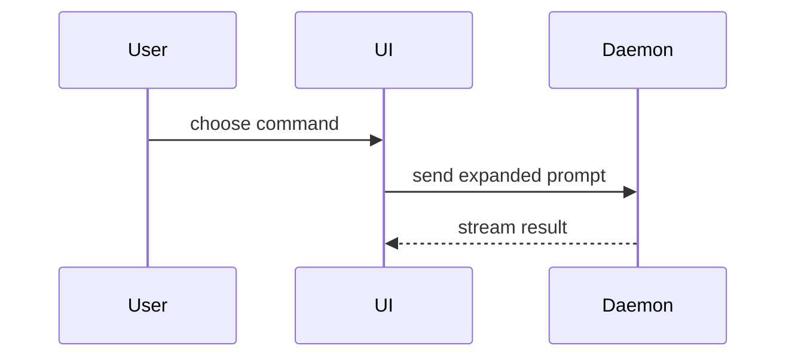

# Show Me

Input: `[what to show, or nothing for the current topic]`

Make the topic visible. Open with the one or two sentences of the answer, then the smallest view that carries it, then stop. A one-sentence answer beats a view that adds nothing. No preamble, no recap of the question.

When the topic is a wall of prose, restate it as views, with prose only for what they cannot show. Nothing to show: say so and stop.

## Views

Logic or an algorithm, as pseudocode:

```text
on(save)
  if content is unchanged
    return cached result
  write new content
  return fresh result
```

Runtime control flow, as a call tree:

```text
submitForm
  createSession
    persistPrompt
    launchAgent
  navigateToSession
```

UI structure, as a component tree carrying the state and module boundaries that matter:

```tsx
<SessionPage> (apps/example/src/routes/session.tsx)
  useSessionEvents()
  <SessionToolbar>
    <RunSkillButton> (packages/ui)
```

A contract before the code exists, as types and signatures:

```ts
interface Cursor {
  position: ItemId
  direction: 'up' | 'down'
}

resolveTarget(items: Item[], cursor: Cursor): ItemId | null
```

Options against criteria, as a table, the recommended option first:

| Criterion | Option A | Option B |
|---|---|---|
| Cost | low | high |
| Speed | slow | fast |

Events in order, as a timeline:

```text
09:12  deploy v2.3 starts
09:14  error rate rises on /checkout
09:20  rollback to v2.2; errors stop
```

File responsibility or a broad refactor, as a shallow file tree:

```text
src/
├── commands/       # parses user actions
├── sessions/       # owns session state
└── transport/      # sends API requests
```

Component interaction or state transitions, as a Mermaid sequence or state diagram, only where Mermaid renders (a pull request, a Markdown page on a forge, an HTML page that loads Mermaid, an interface that renders it); elsewhere a call tree for interactions or one `state --event--> state` line per transition:



## Diffs

Use `diff` when the point is what changes and the surrounding shape already exists. Match the diff shape to the topic.

A component change:

```diff
 <SessionPage>
   useSessionEvents()
   <SessionToolbar>
+    <RunSkillButton />
   <SessionTimeline>
+    <SkillResultCard />
```

A file-layout change:

```diff
 src/
 ├── commands/
+│   └── show-me.ts       # expands the command
 ├── sessions/
-└── transport.ts
+└── transport/
+    ├── client.ts
+    └── stream.ts
```

A call-tree change:

```diff
 submitForm
   createSession
     persistPrompt
+    expandSkillMention
     launchAgent
-  navigateToSession
+  navigateToSession
+    subscribeToEvents
```

A state or control-flow change:

```diff
 on(save)
-  write content
+  if content is unchanged
+    return cached result
+  write new content
+  invalidate cache
```

Show the whole block instead when most of it is new, when omitted context would hide ownership or order, or when the user needs a copyable target shape:

```ts
function expandSkill(command: string): string {
  const skillName = command.slice(1)
  return `use the ${skillName} skill`
}
```

## HTML page

For a visual UI, a layout, a state comparison, or a concept too dense for Mermaid, write one focused HTML file: a diagram, an infographic, or a short slide deck, whichever fits the point. Add interaction only where it teaches: step-through for a sequence, a slider for a parameter, animation for change over time. The page must still make sense with no interaction, and every control must work from the keyboard. Match the product's colors, type, spacing, and components; use real labels and real data; support desktop and mobile. Save it as `show-me-<description>.html` in a temporary directory, open it in the default browser when you can, and give its path.

## Scope

Keep only the calls, files, props, states, and boundaries that answer the current question or separate the options on the table. One view usually, several sometimes, all of them never.
